<p align="center">
  
</p>

<p align="center">
  <a href="#contents"></a>
  <a href="#contents"></a>
  <a href="#appendix-b-measurement-scripts"></a>
  <a href="#part-v-arabic-inference-hygiene"></a>
  <a href="https://github.com/h9-tec/LLM-Inference-Handbook"></a>
  <a href="#license"></a>
</p>

<p align="center">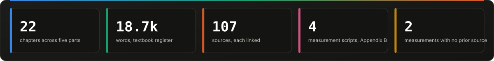</p>

# The LLM Inference Handbook, Volume II

## Production Failure Modes: What Breaks After the Benchmark Passes

**Status:** complete first edition. 22 chapters, 5 parts, 2 appendices, about 18,700 words.

**Prerequisite:** [Volume I](https://github.com/h9-tec/LLM-Inference-Handbook) (fundamentals through production serving). This volume does not repeat it. Where a chapter here depends on a Volume I concept (KV cache sizing, prefill/decode asymmetry, PagedAttention, goodput), it is referenced by name and assumed known.

| If you are | Start at | Then |
|---|---|---|
| Running vLLM or SGLang in production today | [Chapter 6](#6-where-the-tail-lives-preemption-admission-and-the-scheduler-defaults) and [Chapter 8](#8-prefix-cache-invalidation-mechanics-templates-hybrids-lora-and-json) | [Appendix A](#appendix-a-production-audit-checklist-for-volume-ii) |
| Shipping a quantized checkpoint | [Chapter 4](#4-quantization-evals-that-lie-benchmarks-kl-divergence-and-human-raters) | [Chapter 2](#2-fp8-kv-cache-the-accumulator-not-the-format), [Chapter 3](#3-nvfp4-and-mxfp4-a-structural-hole-at-the-top-of-every-block) |
| Serving agents or coding assistants | [Chapter 7](#7-prefix-cache-ceilings-what-production-traces-actually-show) | [Chapter 17](#17-agentic-workloads-goodput-sticky-routing-and-the-turn-boundary) |
| Sizing hardware or an interconnect | [Chapter 13](#13-tensor-parallel-decode-is-a-latency-problem-not-a-bandwidth-problem) | [Chapter 12](#12-the-launch-floor-cuda-graph-capture-lists-and-the-framework-tax), [Chapter 14](#14-power-clocks-and-co-tenant-contention) |
| Serving Arabic | [Chapter 20](#20-arabic-text-hygiene-json-escaping-unicode-normalization-and-diacritics) | [Appendix B](#appendix-b-measurement-scripts) |

---

## Why a second volume

Volume I explains how inference systems are supposed to work. This volume is about the gap between that and what a deployment does on a Tuesday afternoon under real traffic.

Every chapter here was selected by one test: the failure it describes does not appear in a benchmark run on a quiet GPU with synthetic prompts, and it does appear once the same system meets real users, real templates, real text, and real load. Most of these failures are not in any serving framework's documentation. Several are visible only by reading the scheduler source. A few, in the Arabic part, were measured for this handbook because no published source existed.

The organizing claim of the book is this: **in 2026 the serving stack is no longer the bottleneck. The bottleneck is the set of assumptions that the stack silently makes about your workload.** Batch-invariant arithmetic, stable prompt prefixes, English-shaped text, ASCII-safe serializers, 16-token cache blocks, draft models that agree with the target, benchmarks that resemble traffic. Each assumption holds in the demo and fails in production, and each failure has a number attached that you can check against your own system.

Every chapter ends with the primary sources. Where a number comes from a preprint that has not been independently reproduced, it is marked. Where a number was measured for this handbook, the script is in Appendix B so you can rerun it on your own tokenizer and corpus.

---

## The map

<p align="center">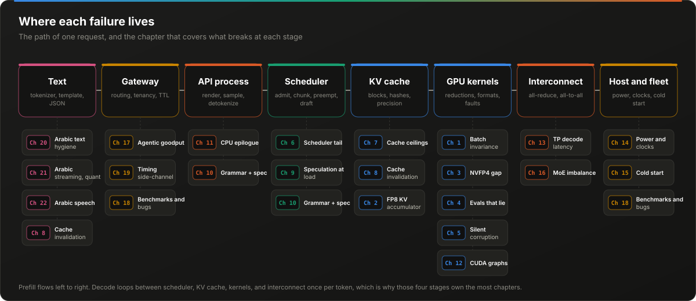</p>

<p align="center">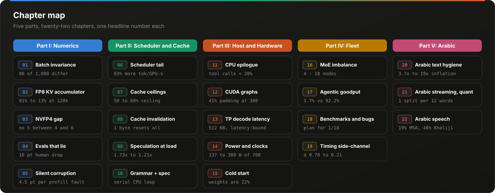</p>

---

## Contents

**Part I: Numerics and Determinism**

1. [Batch Invariance: Why Temperature Zero Is Not Deterministic](#1-batch-invariance-why-temperature-zero-is-not-deterministic)
2. [FP8 KV Cache: The Accumulator, Not the Format](#2-fp8-kv-cache-the-accumulator-not-the-format)
3. [NVFP4 and MXFP4: A Structural Hole at the Top of Every Block](#3-nvfp4-and-mxfp4-a-structural-hole-at-the-top-of-every-block)
4. [Quantization Evals That Lie: Benchmarks, KL Divergence, and Human Raters](#4-quantization-evals-that-lie-benchmarks-kl-divergence-and-human-raters)
5. [Silent Data Corruption: Bit Flips, dtype Sensitivity, and Why NaN Checks Miss It](#5-silent-data-corruption-bit-flips-dtype-sensitivity-and-why-nan-checks-miss-it)

**Part II: Scheduler and Cache Internals**

6. [Where the Tail Lives: Preemption, Admission, and the Scheduler Defaults](#6-where-the-tail-lives-preemption-admission-and-the-scheduler-defaults)
7. [Prefix Cache Ceilings: What Production Traces Actually Show](#7-prefix-cache-ceilings-what-production-traces-actually-show)
8. [Prefix Cache Invalidation Mechanics: Templates, Hybrids, LoRA, and JSON](#8-prefix-cache-invalidation-mechanics-templates-hybrids-lora-and-json)
9. [Speculative Decoding Under Load: Acceptance Dynamics and the Batch-Size Cliff](#9-speculative-decoding-under-load-acceptance-dynamics-and-the-batch-size-cliff)
10. [Structured Output Meets Speculation: The Serial Path Nobody Benchmarks](#10-structured-output-meets-speculation-the-serial-path-nobody-benchmarks)

**Part III: The Host and Hardware Path**

11. [The CPU Side: Sampling, Detokenization, and the API Server](#11-the-cpu-side-sampling-detokenization-and-the-api-server)
12. [The Launch Floor: CUDA Graph Capture Lists and the Framework Tax](#12-the-launch-floor-cuda-graph-capture-lists-and-the-framework-tax)
13. [Tensor Parallel Decode Is a Latency Problem, Not a Bandwidth Problem](#13-tensor-parallel-decode-is-a-latency-problem-not-a-bandwidth-problem)
14. [Power, Clocks, and Co-Tenant Contention](#14-power-clocks-and-co-tenant-contention)
15. [Cold Start Is CPU-Bound](#15-cold-start-is-cpu-bound)

**Part IV: Fleet Realities**

16. [MoE Expert Imbalance and the DeepSeek Disclosure](#16-moe-expert-imbalance-and-the-deepseek-disclosure)
17. [Agentic Workloads: Goodput, Sticky Routing, and the Turn Boundary](#17-agentic-workloads-goodput-sticky-routing-and-the-turn-boundary)
18. [Benchmarks That Overstate Capacity and Bugs That Pass Evals](#18-benchmarks-that-overstate-capacity-and-bugs-that-pass-evals)
19. [KV Cache Timing Side Channels in Multi-Tenant Serving](#19-kv-cache-timing-side-channels-in-multi-tenant-serving)

**Part V: Arabic Inference Hygiene**

20. [Arabic Text Hygiene: JSON Escaping, Unicode Normalization, and Diacritics](#20-arabic-text-hygiene-json-escaping-unicode-normalization-and-diacritics)
21. [Streaming, Quantization, and Speculation for Arabic](#21-streaming-quantization-and-speculation-for-arabic)
22. [Arabic Speech Inference: Whisper, Dialects, and Silence](#22-arabic-speech-inference-whisper-dialects-and-silence)

**Appendices**

- [Appendix A: Production Audit Checklist for Volume II](#appendix-a-production-audit-checklist-for-volume-ii)
- [Appendix B: Measurement Scripts](#appendix-b-measurement-scripts)

---

# Part I: Numerics and Determinism

<p align="center">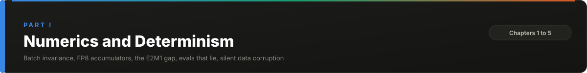</p>

## 1. Batch Invariance: Why Temperature Zero Is Not Deterministic

<p align="center">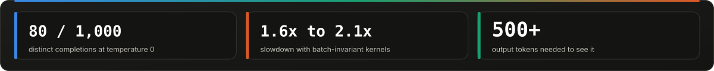</p>

<p align="center">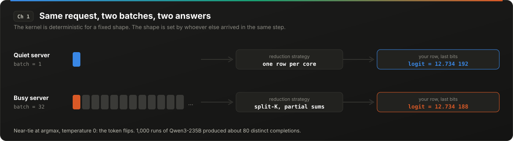</p>

> [!IMPORTANT]
> **At a glance.** Same prompt, temperature 0, 1,000 runs: about 80 distinct completions. The cause is batch composition, not atomics. Batch-invariant kernels cost 1.6x to 2.1x.

### 1.1 The symptom

Set `temperature=0`, send the same prompt to the same model on the same hardware a thousand times, and you get more than one answer. A frequently cited experiment on Qwen3-235B at temperature zero produced roughly 80 distinct completions out of 1,000 runs. The divergence usually begins deep in the output, after a long shared prefix, which is why short tests do not catch it.

The common explanation is "floating-point non-associativity plus GPU concurrency": parallel reductions finish in different orders, (a+b)+c differs from a+(b+c), and the error propagates. That explanation is incomplete. It describes a necessary condition but not the mechanism that actually produces nondeterminism in a serving system.

### 1.2 The mechanism

In the typical forward pass of an LLM there are almost no atomic adds. Each individual kernel, run on the same input with the same shape, produces the same bits every time. The forward pass is **run-to-run deterministic** for a fixed batch.

What is not fixed is the batch. In a continuously batched server, your request shares a forward pass with whatever else arrived in the same scheduling step. The batch size seen by the kernels is a function of server load, which from the user's perspective is random. And most kernels are not **batch-invariant**: the result they compute for row *i* depends on how many other rows are in the batch, because the reduction strategy (tile shape, split-K factor, number of parallel partial sums) is chosen based on the total shape.

Three kernel families are responsible for almost all of it:

- **RMSNorm.** The reduction over the hidden dimension is split differently when the batch is small (to fill the GPU) versus large (one row per core). Different split, different summation order, different rounding.
- **Matrix multiplication.** cuBLAS and similar libraries select a kernel configuration per shape. Small-M shapes often use split-K, which partitions the reduction dimension across thread blocks and sums partials afterward. Large-M shapes do not.
- **Attention.** FlashAttention-style kernels and their decode variants (split-KV, FlashDecoding) partition the sequence dimension based on how much parallelism is available, which again depends on batch composition.

The practical consequence: the logits for your request at batch size 1 and batch size 32 differ in the last bits. At temperature zero, argmax over logits that differ by 1e-6 flips a token whenever two candidates are nearly tied, and in a long generation there is always eventually a near tie.

### 1.3 The fix and its cost

The fix is to make each kernel's result for one row independent of the other rows. Concretely: pick one reduction strategy and use it for every shape. For RMSNorm, always reduce one row per core. For matmul, compile a single kernel configuration and never use split-K regardless of M. For attention, fix the split-KV factor (or choose it from the KV length alone, never from batch size), and ensure the prefill and decode paths reduce in the same order.

Published results with such kernels on vLLM: 1,000 of 1,000 completions bitwise identical, versus roughly 80 distinct completions with stock kernels. The cost in the same post, on Qwen3-8B generating 1,000 sequences: 26 s with default vLLM, 55 s with the unoptimized deterministic kernels, 42 s after an improved attention kernel, which is a 1.6x to 2.1x slowdown, because the single fixed configuration is suboptimal for most shapes.

A separate line of work extends this to **tensor-parallel size invariance**: the same model at TP=2 and TP=8 reduces across devices in different orders, so a trained policy evaluated at a different TP than the one used during RL rollout sees different logits. The reported consequence is training/inference mismatch in on-policy RL, which is why RL labs care about this more than chat products do.

### 1.4 When it matters and when it does not

The honest position is that bitwise determinism is a requirement for a minority of workloads:

| Workload | Needs batch invariance? | Why |
|---|---|---|
| Consumer chat | No | Distributional stability is enough |
| Offline evals, LLM-as-judge | Yes | Score variance of several points from nondeterminism alone has been reported; the eval becomes a measurement of load |
| On-policy RL rollouts | Yes | Mismatch between sampler and trainer logits is a known source of training instability |
| Regulated outputs (legal, medical records) | Usually | Reproducibility on audit |
| Caching by exact output hash | Yes | Otherwise the cache never hits |
| Agent loops with retries | Partially | Nondeterminism is sometimes desirable for escaping failure loops |

A useful framing from the literature distinguishes three goals: **bitwise determinism** (same bits under any load), **distributional reproducibility** (the output distribution is stable across seeds, hardware, and batching), and **semantic stability** (meaning and safety properties preserved under sampling). Most products need the second and third. Evaluation pipelines need the first, and they need it more than people assume: reported accuracy fluctuations of double-digit percentage points across repeated temperature-zero runs are entirely consistent with the mechanism above, because an eval suite is a long sequence of near-tie decisions.

### 1.5 What to do

1. Decide which of the three goals you need per workload. Write it down.
2. For evals, either run with a batch-invariant kernel set, or run every eval at a fixed batch size on a dedicated instance and record the batch size as part of the eval metadata. The second option is cheaper and catches most of the problem.
3. For RL, match TP size and kernel configuration between rollout and training, or use the invariant kernels.
4. Never test determinism with short prompts. Use outputs of at least 500 tokens.
5. `seed` parameters on hosted APIs control sampling, not batching. They do not give you this guarantee.

<details>
<summary><b>Sources</b></summary>

- Horace He and Thinking Machines Lab, "Defeating Nondeterminism in LLM Inference" (2025): https://thinkingmachines.ai/blog/defeating-nondeterminism-in-llm-inference/
- "Deterministic Inference Across Tensor Parallel Sizes That Eliminates Training–Inference Mismatch," arXiv 2511.17826: https://arxiv.org/abs/2511.17826
- "Stochastic CHAOS" (the three stability goals), arXiv 2601.07239: https://arxiv.org/pdf/2601.07239
- Related: BF16 greedy decoding non-reproducibility across batch size, GPU count and GPU type, arXiv 2506.09501: https://arxiv.org/abs/2506.09501


</details>

<p align="right"><a href="#contents">Back to contents</a></p>

---

## 2. FP8 KV Cache: The Accumulator, Not the Format

<p align="center">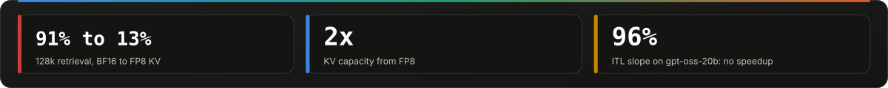</p>

<p align="center">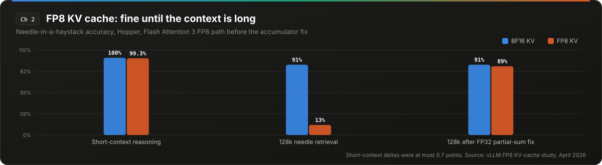</p>

> [!IMPORTANT]
> **At a glance.** FP8 KV cache went from 91% to 13% on a 128k retrieval task, from accumulator precision, invisible below 32k. Validate at the longest context you serve.

### 2.1 Why FP8 KV cache is the right default

Volume I established that long-context decode is bandwidth-bound on the KV cache read. Storing the cache in FP8 (e4m3) halves the bytes per token, doubles the number of concurrent sequences that fit in HBM, and on Hopper and Blackwell lets the attention matmuls themselves (QK and score-times-V) run on FP8 tensor cores. vLLM's `--kv-cache-dtype fp8` does all of this, and in published measurements it delivers roughly 2x KV capacity with negligible loss on short and medium contexts.

That last qualifier is the chapter.

### 2.2 The 91% to 13% regression

On a 128k-token needle-in-a-haystack task, the FP8 KV-cache path on Hopper was measured at **13% accuracy against 91% for BF16**. Short-context reasoning benchmarks moved by at most 0.7 points on the same configuration. A team that validated FP8 on its usual eval set would have shipped this.

The root cause was not FP8 quantization error. It was the **accumulation precision inside the Flash Attention 3 FP8 kernel**. The kernel's accumulator is nominally FP32, but the implementation held partial sums in a way that lost precision once the contraction dimension (the number of keys attended over) reached roughly 100,000. The error is a function of sequence length, which is exactly why it is invisible below 32k and catastrophic at 128k. Writing partial sums to a true FP32 register restored accuracy to 89%, and the optimized FP8 path retained its decode-speed advantage after the fix.

The lesson generalizes beyond one kernel: **any reduced-precision attention path has an accumulation error that grows with context length, and the only eval that catches it is one at the longest context you intend to serve.**

### 2.3 Hybrid attention models get almost no speedup

A second finding from the same work concerns models that mix full-attention layers with sliding-window layers (gpt-oss, Gemma 3, several 2026 hybrids). Sliding-window layers have a bounded KV cache regardless of context length, so quantizing them saves little memory and little bandwidth, but still pays the FP8 quantize/dequantize overhead per step. On gpt-oss-20b, FP8 KV cache applied to all layers produced an inter-token latency slope that was 96% of BF16, which is to say no meaningful speedup. The recommended configuration skips those layers:

```
vllm serve gpt-oss-20b --kv-cache-dtype fp8 --kv-cache-dtype-skip-layers sliding_window
```

The general principle: FP8 KV cache pays off in proportion to how much of your decode time is spent reading full-attention KV. For a model where half the layers are windowed, half the benefit is gone before you start.

### 2.4 Below FP8: where low-bit KV breaks

Studies of 3- and 4-bit KV-cache storage formats (which compress storage only and dequantize to BF16 for the matmul, unlike FP8 which also quantizes the computation) show a consistent pattern: accuracy holds at 32k and 64k and degrades at 128k to 256k. The error accumulates with sequence length, and the degradation concentrates on exactly the long-context retrieval tasks that justified buying the capacity. Three-bit variants show meaningful loss at long context; 4-bit with 8-bit keys is closer to FP8. The outlier structure of keys (a few channels with large magnitude, and the attention-sink token with anomalous values) is why keys are harder to quantize than values and why rotation-based and sink-aware schemes exist.

### 2.5 What to do

1. Validate any KV-cache precision change at the **maximum** context length you serve, with a retrieval-style task, not a reasoning benchmark.
2. On hybrid-attention models, skip windowed layers.
3. Treat FP8 as the production default and anything below it as a per-model experiment.
4. Confirm that your attention backend has fused support for the quantized format. A backend without it dequantizes in a separate pass and can be slower than BF16.
5. When upgrading the serving framework, rerun the long-context eval. The accumulation fix above shipped as a kernel change; your version may predate or postdate it.

<details>
<summary><b>Sources</b></summary>

- vLLM, "The State of FP8 KV-Cache and Attention Quantization in vLLM" (April 2026): https://vllm.ai/blog/2026-04-22-fp8-kvcache
- vLLM, "A First Comprehensive Study of TurboQuant" (May 2026): https://vllm.ai/blog/2026-05-11-turboquant
- SGLang quantized KV cache documentation: https://docs.sglang.io/advanced_features/quantized_kv_cache.html
- KVQuant (outlier structure in keys), arXiv 2401.18079: https://arxiv.org/abs/2401.18079
- RotateKV (attention-sink-aware quantization), arXiv 2501.16383: https://arxiv.org/pdf/2501.16383.pdf


</details>

<p align="right"><a href="#contents">Back to contents</a></p>

---

## 3. NVFP4 and MXFP4: A Structural Hole at the Top of Every Block

<p align="center">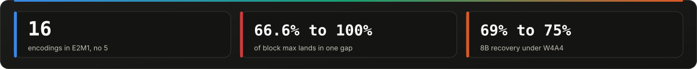</p>

<p align="center">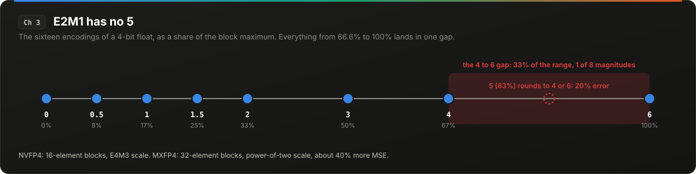</p>

> [!IMPORTANT]
> **At a glance.** E2M1 has no 5. Every value between 66.6% and 100% of the block max sits in one gap. Hadamard rotation hurts NVFP4. 8B models recover only 69% to 75% under W4A4.

### 3.1 What a 4-bit float can represent

FP4 in the E2M1 layout (2 exponent bits, 1 mantissa bit) represents exactly sixteen values: ±{0, 0.5, 1, 1.5, 2, 3, 4, 6}. There is no 5. There is nothing between 4 and 6. In a block-scaled format, each block of 16 (NVFP4) or 32 (MXFP4) elements is scaled so that its maximum magnitude maps to 6, and every other element is rounded to the nearest representable value on that grid.

Consider what that means for the elements near the top of the block. An element at 83% of the block max would map to 5.0, which does not exist; it rounds to 4 or 6, an error of 20% of its own magnitude. Every element between 66.6% and 100% of the block max lands in the gap between 4 and 6. This is a structural property of the format, not an artifact of any particular quantizer, and it is why NVFP4 error is dominated by values in that band.

### 3.2 Measured consequences

On Llama-3.1-8B, WikiText-2 perplexity moves from 7.54 (BF16) to 8.43 (NVFP4 weights and activations). A scaling trick that targets the 4-to-6 gap specifically (scaling so that the band is better covered) recovers to 8.30. MXFP4, whose per-block scale is restricted to powers of two (E8M0), adds roughly 40% relative mean-squared error on top of NVFP4's finer E4M3 scale.

Two findings cut against INT4 intuition:

**Hadamard rotation hurts NVFP4 under round-to-nearest.** Rotation is the standard INT4 fix for outliers: spread one large value across many channels so no single element saturates the range. In NVFP4, the 16-element block already isolates the outlier (it becomes the block max and is represented exactly as 6 times the scale). Rotation takes that exactly-represented outlier and smears its error across the whole block. The published result is that rotation degrades NVFP4 quality in the common configuration.

**Small models do not survive W4A4.** Llama-3.3-70B recovers 99.07% of baseline accuracy under NVFP4 and 97.88% under MXFP4. Llama-3.1-8B under W4A4 recovers roughly 75% (NVFP4) and 69% (MXFP4). The large-model numbers are what vendors publish. If your deployment is an 8B model, the format behaves differently.

### 3.3 Why this matters more for non-English

Chapter 4 and Chapter 21 return to this with measurements, but the mechanism is worth stating here: the tokens, embeddings, and intermediate activations for lower-resource languages occupy regions of the model that received less gradient signal during training. Those regions tend to have less redundancy, so the same quantization error removes a larger fraction of the usable information. A 4-bit format that costs English 4 points on a benchmark has been measured to cost Arabic 11 points on the same benchmark with the same model.

### 3.4 What to do

1. Treat the vendor's 70B recovery number as an upper bound. Measure on your model size.
2. Do not carry over INT4 rotation recipes to NVFP4 without re-measuring.
3. If you serve an 8B-class model, FP8 is the safe activation format; reserve 4-bit for weights only (W4A16 or W4A8).
4. Measure in the languages you serve. See Chapter 4 for which metrics to trust.

<details>
<summary><b>Sources</b></summary>

- NVFP4 error analysis and the 4/6 scaling result, arXiv 2512.02010: https://arxiv.org/html/2512.02010v4
- Hadamard rotation and NVFP4 under round-to-nearest, arXiv 2509.23202: https://arxiv.org/pdf/2509.23202


</details>

<p align="right"><a href="#contents">Back to contents</a></p>

---

## 4. Quantization Evals That Lie: Benchmarks, KL Divergence, and Human Raters

<p align="center"></p>

<p align="center">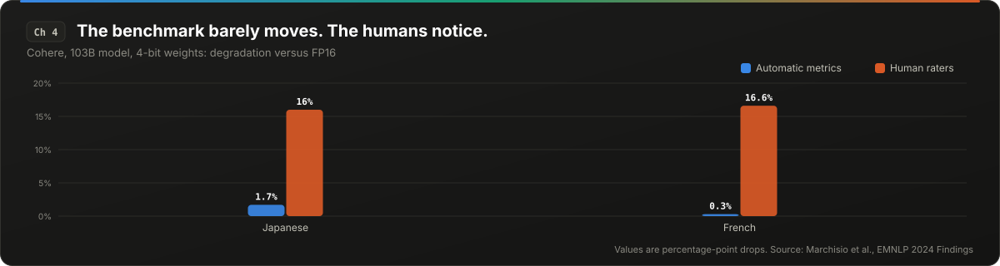</p>

> [!IMPORTANT]
> **At a glance.** MMLU went up after quantization while KL divergence moved. Humans saw a 16-point drop where metrics saw 1. English calibration costs Arabic 3x to 4x what it costs English.

### 4.1 The benchmark that goes up

Fireworks published a case that every quantization team should memorize: a quantized model scored **0.6766 on MMLU against 0.6763 at FP16**. The benchmark went up. The KL divergence between the quantized and FP16 output distributions was 0.00574, versus 1.33e-6 for the FP16 model against itself; the next quantization level up scored lower on MMLU at a KLD of 0.00596, and the level after that reached 0.01224. Fireworks' published gate is a combination of KLD, generation-level divergence, and rejection rate rather than a single KLD threshold. A team gating on MMLU alone would have concluded the quantization was lossless.

Meta's inference team has said publicly that most standard benchmarks are saturated for current models, and that customers report breakage after quantized releases that internal benchmarks did not predict.

The mechanism is simple. A multiple-choice benchmark measures whether argmax lands on the right letter. Quantization perturbs the full distribution. A perturbation that leaves argmax unchanged on 99% of questions is invisible to the benchmark and fully visible to a user reading a 500-token generation, where the perturbed distribution is sampled 500 times.

### 4.2 Automatic metrics versus human raters

Cohere's study of quantization on multilingual models is the clearest published demonstration of the gap. On a 103B model at 4-bit:

| Language | Automatic metric delta | Human preference delta |
|---|---|---|
| Japanese | -1.7% | -16.0% |
| French | -0.3% | -16.6% |

Human raters saw a roughly 16-point degradation where the automatic metrics saw roughly one point. Across languages, non-Latin scripts lost 1.9% against 0.7% for Latin scripts at the same bit width. Multilingual math (MGSM) dropped 13.1% on the 35B model. Arabic specifically was roughly -0.1% at 8-bit and -1.2% at 4-bit on the automatic metrics, and the human-rater gap for Arabic was not separately reported.

### 4.3 Calibration language

GPTQ and AWQ calibrate on a sample of text. Nearly all public quantized checkpoints calibrate on English (C4, WikiText, or similar). The effect on other languages is not subtle:

| Model, 3-bit GPTQ, English calibration | Perplexity ratio (quantized / FP16) |
|---|---|
| Qwen2.5-3B, English | 1.35x |
| Qwen2.5-3B, Arabic | 4.37x |
| Llama-3.2-3B, English | 1.39x |
| Llama-3.2-3B, Arabic | 3.65x |

On Arabic GlobalMMLU, Qwen2.5-3B went from 48.7 to 28.0 under that configuration. At 4-bit NF4 on Gemma 4 E4B, English lost 4.3 points on MMLU-ProX Lite and Arabic lost 11.4; Qwen 3.5 4B lost only 2.7 in Arabic, so the damage is architecture-dependent, not purely a function of script.

The practical reading: a 3x to 4x larger quantization cost for Arabic than for English is the expected outcome of English calibration on a small model, not an anomaly.

### 4.4 A gating protocol that works

1. **Gate on KL divergence of the full next-token distribution**, computed on a held-out set in every language you serve, with a threshold you set empirically by correlating against human review. Fireworks' table puts the acceptable band for English on a 70B-class model somewhere below a KLD of 0.006, with 0.012 clearly too high; treat that as an order of magnitude, not a rule, and expect to need a tighter threshold for small models and non-English.
2. **Keep benchmarks as a sanity check, not a gate.** A benchmark that goes up after quantization is a sign the benchmark is saturated, not that the quantization is free.
3. **Calibrate on text in the languages you serve**, in roughly the proportion you serve them.
4. **Human-review long generations**, not short answers. The damage shows up in coherence over hundreds of tokens.
5. **Rerun on every new quantized checkpoint**, including minor revisions. Quantized artifacts from third parties should be treated as new models.

<details>
<summary><b>Sources</b></summary>

- Fireworks, "Quantization" (the MMLU-up case and KLD gate): https://fireworks.ai/blog/fireworks-quantization
- Meta inference team talk (saturated benchmarks, customer breakage), InfoQ: https://www.infoq.com/presentations/llm-meta
- Cohere, "How Does Quantization Affect Multilingual LLMs?", EMNLP 2024 Findings, arXiv 2407.03211: https://arxiv.org/pdf/2407.03211
- 3-bit GPTQ with English calibration, Arabic perplexity, arXiv 2608.11786 (preprint): https://arxiv.org/html/2608.11786
- NF4 on small models, Arabic versus English, arXiv 2608.09941 (preprint): https://arxiv.org/html/2608.09941
- Counter-evidence (GGUF k-quants on Llama 3.3 70B, no significant multilingual penalty, but only English, Norwegian, Malayalam tested), arXiv 2503.03592: https://arxiv.org/html/2503.03592v1


</details>

<p align="right"><a href="#contents">Back to contents</a></p>

---

## 5. Silent Data Corruption: Bit Flips, dtype Sensitivity, and Why NaN Checks Miss It

<p align="center"></p>

<p align="center">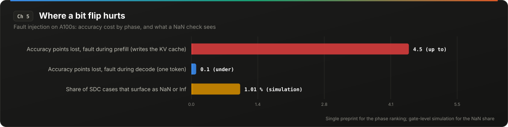</p>

> [!IMPORTANT]
> **At a glance.** A fault in prefill costs up to 4.5 accuracy points; in decode, under 0.1. bf16 ranks worst for fault tolerance. NaN checks catch about 1% of silent corruption.

### 5.1 The field rate

Silent data corruption (SDC) is a hardware fault that produces a wrong value without an error signal. Meta reports an SDC rate of roughly **1 fault per 1,000 devices** across its AI fleet. ECC memory catches most memory faults; it does not catch faults in arithmetic units, register files, or interconnect that are outside ECC coverage, and it does not catch the class of SDC that produces a correctable-looking but wrong value.

The training community has studied this for years because a flipped bit in a gradient can poison a checkpoint. The inference community has mostly assumed it does not apply: inference is stateless, a bad token is one bad token, and the next request is fine. That assumption is wrong in one specific way.

### 5.2 Where inference is sensitive

Fault-injection experiments on A100s (Phi-3.5, DeepSeek-7B, Gemma-7B) found:

- **Prefill is the sensitive phase.** Computation faults injected during the first-token stage cost up to 4 to 5 accuracy points. Faults injected during decode cost under 0.1. The reason is that prefill writes the KV cache that every subsequent token reads; a corrupted key or value is reused for the rest of the generation, while a corrupted decode activation affects one token.
- **bfloat16 is the worst dtype for fault tolerance.** Recovery ranked quantized integer formats best, then fp16, then fp32, then bf16 last. bf16's 8-bit exponent means a single flipped exponent bit changes magnitude by a factor of up to 2^128. In fp16, flipping bit 14 (the top exponent bit) dropped accuracy to 62.79 versus 80.46 to 92.89 for any other bit.
- **NaN checks catch almost nothing.** A gate-level simulation study found NaN or Inf outcomes in 1.01% of SDC cases, and single-bit flips in under 40%. The remaining majority produce a finite, plausible, wrong number. (This is simulator-based and has not been validated against field logs.)

### 5.3 Fleet-level numbers

On the Delta cluster, H100s showed a 3.2x lower per-GPU mean time between uncorrectable ECC errors than A100s. Recovery mechanisms mitigated 92% of those. Maintaining 99.9% job availability required roughly 5% overprovisioning. These are training-cluster numbers, but the GPUs are the same, and an inference fleet of the same size will see the same raw fault rate; it just will not have a loss curve to notice it on.

### 5.4 What to do

1. **Run periodic self-checks on inference GPUs.** A fixed prompt at a fixed batch size with a known-good output hash (Chapter 1 explains why the batch size must be fixed). A mismatch on a GPU that previously matched is a hardware signal, not a model signal.
2. **Consider fp16 or FP8 over bf16 for inference**, but only after checking activation range. The dtype ranking above comes from a single fault-injection preprint and has not been independently reproduced. Several model families (Gemma 2 and 3, the T5 family) produce activation outliers that overflow fp16 and are documented as bf16-only for that reason; for those, fp16 trades a rare hardware fault for a deterministic numerical one. FP8 with per-tensor scaling avoids the overflow problem and is the safer choice where the backend supports it.
3. **Do not rely on NaN detection.** It is a necessary check, not a sufficient one.
4. **Budget 3 to 5% overprovisioning** for GPU health rotation, and build the rotation into the autoscaler rather than into incident response.
5. **Log per-GPU output hashes for a canary set** and alert on drift. Chapter 18 describes how a silent correctness bug at a frontier lab stayed undetected for weeks because the evals did not run on the production path.

<details>
<summary><b>Sources</b></summary>

- Inference fault injection study (dtype ranking, prefill sensitivity), arXiv 2606.02430 (preprint): https://arxiv.org/html/2606.02430v1
- Meta, "How Meta keeps its AI hardware reliable" (2025): https://engineering.fb.com/2025/07/22/data-infrastructure/how-meta-keeps-its-ai-hardware-reliable/
- Delta cluster GPU error characterization, arXiv 2503.11901: https://arxiv.org/html/2503.11901v3
- "The Anatomy of Silent Data Corruption: GPU Error Pattern Study and Modeling Guidance" (gate-level SDC outcome distribution, simulation), arXiv 2605.04213: https://arxiv.org/abs/2605.04213
- Ampere memory error study (weak temperature correlation), arXiv 2508.03513: https://arxiv.org/html/2508.03513v2


</details>

<p align="right"><a href="#contents">Back to contents</a></p>

---

# Part II: Scheduler and Cache Internals

<p align="center">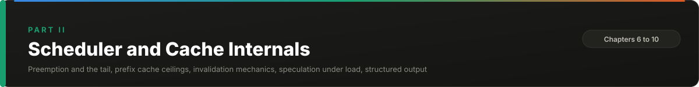</p>

## 6. Where the Tail Lives: Preemption, Admission, and the Scheduler Defaults

<p align="center">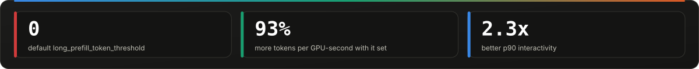</p>

<p align="center">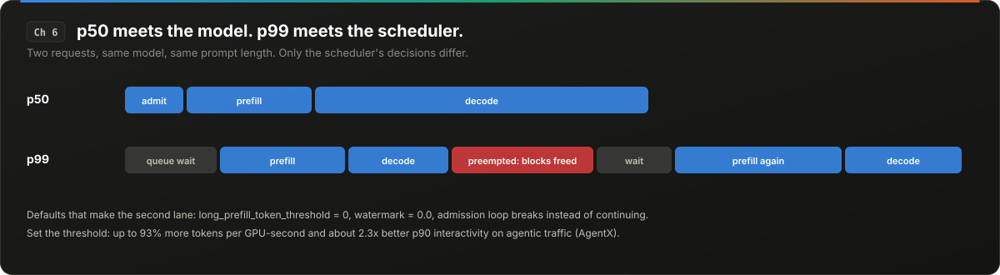</p>

> [!IMPORTANT]
> **At a glance.** p50 meets the model, p99 meets the scheduler. `long_prefill_token_threshold` and `watermark` both default to 0. Setting the threshold gave up to 93% more tokens per GPU-second.

### 6.1 p50 is the model, p99 is the scheduler

Volume I covered continuous batching and chunked prefill as throughput mechanisms. This chapter is about what those mechanisms do to the tail of the latency distribution, and about the scheduler parameters that control it, most of which ship with defaults chosen for throughput benchmarks.

A useful mental model: the median request experiences the model. It is admitted, prefilled, and decoded at the steady-state rate. The p99 request experiences the scheduler. It arrived when the KV pool was nearly full, got preempted, lost its blocks, waited for readmission, and was prefilled again from scratch. Nothing about the model changed between the two requests. The difference is entirely in what the scheduler did to them.

### 6.2 Preemption restarts from zero

When the KV pool runs out of free blocks mid-decode, the scheduler must evict a running sequence. vLLM's eviction is all-or-nothing per sequence (all of a sequence's blocks are released together, because they will all be needed together). The evicted request is returned to the waiting queue with `num_computed_tokens = 0`. When readmitted, it is prefilled again, prompt plus everything it had generated so far.

Two recovery strategies exist. **Swap** copies the evicted blocks to CPU memory and back; cost is linear in sequence length. **Recompute** discards them and re-runs prefill; cost is quadratic in sequence length (attention over the full prefix). In the V1 engine the default is recompute, because the engine's prefill path is fast enough that recompute wins for typical lengths. For long sequences it does not. One study measured FCFS-based preemption producing 9% to 39% more preemptions and 26% to roughly 100% higher tail preemption time than alternatives that preempt the request with the smallest KV footprint or the shortest remaining time.

Whether the recomputed request is fast depends on whether its blocks are still in the prefix cache. The eviction released them to the free pool; if nothing overwrote them before readmission, the prefix cache hit is 100% and recompute is nearly free. Under sustained pressure, which is the only time preemption happens, they are usually overwritten. The request that gets preempted is, by construction, the one that then pays full prefill twice.

The configuration variable `watermark` sets how much of the pool must remain free before a new request is admitted, as a fraction. It defaults to 0.0. There is no anti-thrash headroom unless you set it.

### 6.3 The defaults that create cliffs

Reading the V1 scheduler source (vLLM `main`, late 2026) surfaces several parameters that are rarely touched:

**`long_prefill_token_threshold`** defaults to 0, meaning no cap. One long prompt can consume the entire per-step token budget (`max_num_batched_tokens`) in a single step, during which every running decode waits. Setting it (so that a long prompt is chunked and interleaved with decodes) was measured in the AgentX work at up to 93% more tokens per GPU-second and roughly 2.3x better p90 interactivity on agentic traffic. This is the single highest-leverage scheduler flag for tail latency, and it is off by default.

**Admission uses `break`, not `continue`.** With chunked prefill disabled, when the request at the head of the waiting queue does not fit the remaining token budget, the admission loop breaks. It does not skip to the next request that would fit. A forum reproduction: 16 prompts of 1,024 tokens against a 16,384-token budget admitted only 2, 5, or 7 per step depending on arrival order. The fix is to enable chunked prefill, which is the default in V1 but is sometimes disabled for speculative decoding or for specific hardware backends.

**Speculative decoding pads new decodes to `1 + k` tokens.** A request entering decode with `k` draft tokens needs `1 + k` slots in the step budget. If the budget cannot fit the padded size, the scheduler prefers not to schedule it rather than schedule it unpadded. Under high load with speculation on, this creates a second admission cliff.

**`max_num_queued_tokens` over-counts.** This is the TTFT admission valve: when the sum of queued prompt tokens exceeds it, new requests are rejected. It counts a partially prefilled request at its full prompt length, and it ignores prefix-cache hits (a 60k-token prompt with a 59k cached prefix counts as 60k). On agentic traffic, where prompts are long and mostly cached, it sheds load far earlier than the real capacity.

### 6.4 The p99 contract

Three policies, three tails:

| Scheduling policy | Throughput | p50 | p99 | Suitable for |
|---|---|---|---|---|
| FCFS, big batches, aggressive preemption | Highest | Good | Worst | Offline batch |
| FCFS with chunked prefill and long-prefill threshold | Slightly lower | Good | Good | General online |
| SLO-aware (priority by deadline, preempt largest KV first) | Lower | Good | Best when targets are set correctly | Latency-contracted products |

The reason production numbers diverge from benchmark numbers is almost always that the benchmark ran the first row and production needs the second or third.

### 6.5 What to monitor

- Preemption count (exposed as a Prometheus counter). Any sustained non-zero rate is a capacity or watermark problem.
- Queue wait time as a separate metric from TTFT. In agentic traffic, queue wait has been measured at up to 58% of end-to-end program delay (Chapter 17).
- The fraction of steps where a single prefill consumed the whole token budget.

<details>
<summary><b>Sources</b></summary>

- vLLM V1 scheduler source: https://github.com/vllm-project/vllm/blob/main/vllm/v1/core/sched/scheduler.py
- vLLM scheduler config (defaults): https://github.com/vllm-project/vllm/blob/main/vllm/config/scheduler.py
- Admission break-vs-continue reproduction: https://discuss.vllm.ai/t/vllm-v1-scheduler-inconsistent-request-scheduling-under-token-budget-limit/1241
- vLLM optimization docs (preemption modes, V1 recompute default): https://docs.vllm.ai/en/latest/configuration/optimization/
- CacheOPT: preemption policy and swap-versus-recompute measurements, arXiv 2503.13773: https://arxiv.org/pdf/2503.13773
- Original PagedAttention paper, section 4.5 (all-or-nothing eviction): https://arxiv.org/pdf/2309.06180
- DigitalOcean, "Why your vLLM p99 latency blows up in production": https://www.digitalocean.com/community/conceptual-articles/when-your-vllm-p99
- vLLM AgentX (long-prefill threshold measurements): https://vllm.ai/blog/2026-09-08-vllm-agentx


</details>

<p align="right"><a href="#contents">Back to contents</a></p>

---

## 7. Prefix Cache Ceilings: What Production Traces Actually Show

<p align="center"></p>

<p align="center">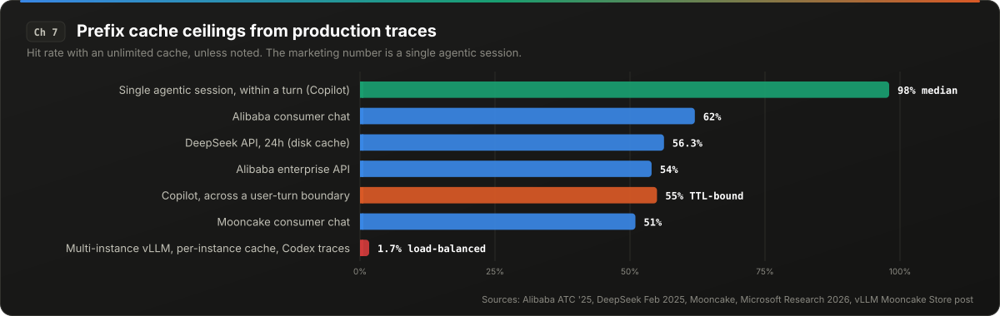</p>

> [!IMPORTANT]
> **At a glance.** The fleet-level prefix-cache ceiling is 50% to 60% even with infinite capacity. 97% of enterprise hits come from single-turn requests. The 98% figure is one agentic turn.

### 7.1 The number everyone quotes and the number operators see

Prefix caching is sold on 85% to 97% hit rates. Those numbers are real, and they come from one specific workload: a single agentic coding session measured within one turn, where every call reuses the previous call's context plus a small delta. They are not fleet numbers.

Three operators have published fleet-level traces with enough detail to compute the ceiling:

| Operator | Workload | Hit rate with unlimited cache | Hit rate at practical capacity |
|---|---|---|---|
| Alibaba (ATC '25) | Consumer chat | 62% | lower, see below |
| Alibaba (ATC '25) | Enterprise API | 54% | roughly the same |
| Moonshot / Kimi (Mooncake) | Consumer chat | 51% | 30% at 1,000 blocks, 50% at 50,000 |
| DeepSeek (Feb 2025, 24h) | Mixed API | not stated | 56.3% (342B of 608B input tokens) |

The ceiling is 50% to 60% for general traffic even with infinite capacity. The rest of the tokens are not reusable because nothing shares their prefix.

### 7.2 What actually produces the hits

The Alibaba enterprise trace is the most detailed:

- 54% of requests are single-turn. Median conversation length is 1 turn; p90 is 5.
- **97% of cache hits come from single-turn requests**, not from multi-turn history. The reuse is the shared system prompt and few-shot block across different users' single requests, not the same user's conversation.
- 10% of cached blocks produce 77% of all reuses.
- 90% of enterprise blocks are dead (never reused again) after 0.3 seconds; p99 is 97 seconds. For consumer traffic the 90% mark is 612 seconds.
- Cross-user hits beyond the shared prefix are rare.
- Capacity needed to reach the ceiling was roughly 4x HBM for Llama3-70B on the consumer trace, and less than the already-reserved HBM on the enterprise trace.

Mooncake reports that over 50% of blocks are never reused at all.

### 7.3 The agentic exception, and where it breaks

GitHub Copilot's production trace (3.2M users, 761M LLM calls, 95T tokens, June 2026) is the largest published agentic-workload measurement:

- Median prefix-cache rate **within a turn** is 98%. The first call in a turn hits 45%, the second 86%, and calls plateau at 92% to 94%.
- **Across a user-turn boundary** the rate drops to 55%. The cause is time-based eviction: cross-turn KV idle time is 172 seconds (human think time), against 1.2 seconds between calls inside a turn.
- A model switch mid-session leaves an 8% average hit rate.
- Context compaction touches 7.8% of sessions, but those sessions carry 44.2% of all tokens, and compaction produces a median 66.1% drop in hit rate, because it rewrites the prefix.
- Median input-to-output ratio exceeds 275:1. Median prompt is 68k tokens.

The 98% figure is true and the 55% figure is also true. Which one your fleet sees depends on eviction TTL relative to human think time, which is a policy choice, not a capacity limit.

### 7.4 Reasoning workloads shift the ratio

Alibaba's ServeGen (NSDI '26) adds the reasoning-model dimension: reasoning tokens average 4x the answer length with a bimodal distribution; multi-turn is only about 10% of deepseek-r1 traffic; input and output lengths drift independently over time by up to 1.63x and 1.46x. Naive workload modeling under-provisioned by 50% (12 instances planned against 25 needed).

### 7.5 What to do

1. **Measure your own ceiling** before buying cache capacity. Replay a day of traffic through an unlimited-capacity simulator and compute the ideal hit rate. If it is 55%, no amount of KV offloading will reach 90%.
2. **Size TTL to the human think-time distribution**, not to memory pressure. For agentic coding, a TTL under 3 minutes evicts the prefix exactly when the user is about to send the next turn.
3. **Route by session**, not by load (Chapter 17). A prefix cached on instance A is worthless if the next turn lands on instance B.
4. **Treat compaction and model switches as cache-cold events** and schedule them when the user is not waiting.
5. Report hit rate per workload class, not as a fleet average. A fleet average of 70% can be a 98% agentic class plus a 30% single-turn class.

<details>
<summary><b>Sources</b></summary>

- Alibaba, prefix cache traces, ATC '25, arXiv 2506.02634: https://arxiv.org/html/2506.02634v4
- Mooncake (Kimi), arXiv 2407.00079: https://arxiv.org/pdf/2407.00079
- DeepSeek-V3/R1 inference system overview (Feb 2025): https://github.com/deepseek-ai/open-infra-index/blob/main/202502OpenSourceWeek/day_6_one_more_thing_deepseekV3R1_inference_system_overview.md
- Microsoft Research, "Agentic Coding in the Wild" (Copilot traces, 2026): https://www.microsoft.com/en-us/research/wp-content/uploads/2026/08/ghcp_traces-6.pdf
- NVIDIA Dynamo agentic inference digest (the 85-97% single-session figure): https://docs.nvidia.com/dynamo/digest/agentic-inference
- Cursor, token efficiency (cold misses cut 20%, cost down 7%): https://cursor.com/blog/improved-token-efficiency
- Alibaba ServeGen, NSDI '26, arXiv 2505.09999: https://arxiv.org/html/2505.09999v2


</details>

<p align="right"><a href="#contents">Back to contents</a></p>

---

## 8. Prefix Cache Invalidation Mechanics: Templates, Hybrids, LoRA, and JSON

<p align="center"></p>

<p align="center">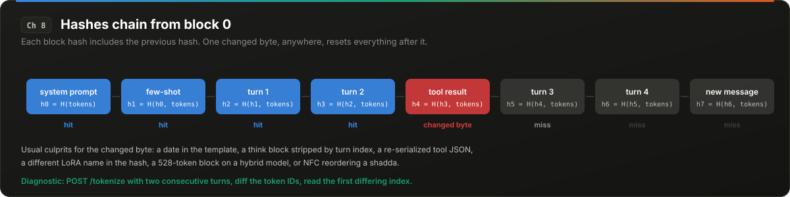</p>

> [!IMPORTANT]
> **At a glance.** One changed byte resets every block after it. The usual culprits: a date in the template, think blocks stripped by turn index, re-serialized tool JSON, LoRA names, 528-token hybrid blocks, NFC.

### 8.1 Hashes chain from the first block

Volume I described prefix caching as hashing each block of tokens and reusing matching blocks. The detail that matters here: each block's hash incorporates the hash of the previous block. A change to token 3 changes the hash of block 0, and therefore of every block after it. There is no partial credit. The cache is a prefix cache in the strict sense: the match is the longest exactly-identical leading run of tokens, and one differing byte anywhere resets everything after it.

Every failure in this chapter is a case where something upstream of the engine changes a byte that the application believes is constant.

### 8.2 Chat templates that rewrite history

Templates are Jinja programs, and several ship behavior that invalidates the cache by design:

**Time in the system prompt.** The gpt-oss template injects `"Current date: " + strftime_now("%Y-%m-%d")` into the system message. Because the system message is block 0, every cached prefix on the server goes cold at local midnight. A fleet with 60% hit rate at 23:59 has 0% at 00:00 and recovers over the next hour. The fix is to override the template or pass a fixed date string.

**Retroactive rewriting of earlier turns.** The Qwen3 template renders `<think>` reasoning blocks only for assistant turns that come after `last_query_index`, the position of the last user message that is not a tool response. In plain chat, every assistant turn in the history sits before that index, so none of them is rendered with a think block and the history is stable; the only loss is the most recent generated turn, whose KV (prompt plus `<think>` plus answer) does not match its stripped rendering in the next request. The failure is in agentic tool loops: while a loop runs, every assistant turn after the original user query is after `last_query_index`, so a client that echoes `reasoning_content` back gets the think blocks rendered. The next real user message moves the index past all of them, strips every think block at once, and changes every block from the first in-loop assistant turn onward. This is not a bug; it is the model's intended training format. Design around it by never echoing `reasoning_content` into the history, so the server-rendered loop is stable.

**Tool-call JSON re-serialization.** A tool result stored as `{"city":"Boston"}` and re-rendered by a different serializer as `{"city": "Boston"}` (one added space) changes the token sequence from the first tool call onward. Serializers that sort keys, or that differ in float formatting, produce the same effect. This failure is common in agent frameworks that round-trip tool results through a database.

**The diagnostic.** Render two consecutive turns through the engine's own template path and diff the token IDs. In vLLM, `POST /tokenize` accepts a `messages` array and returns the token IDs the chat template produces; vLLM also ships a GPU-less render server for the same job (`vllm/entrypoints/launchers/render`), and other engines have an equivalent tokenize route. The first differing position tells you exactly where the cache stops. This takes five minutes and replaces most speculation about cache capacity.

### 8.3 Hybrid Mamba models: the 528-token block

Models that mix attention layers with Mamba or other state-space layers (Qwen3.5, Nemotron-H, Jamba, Falcon-H1) require the KV manager to store attention KV blocks and Mamba state snapshots in the same pool. The Mamba state for a layer is large and fixed-size per sequence, and vLLM's hybrid KV cache manager pads the attention block size up so that one attention page is at least as large as one Mamba page. For Qwen3.5-4B the engine logs: "Setting attention block size to 528 tokens to ensure that attention page size is >= mamba page size." The design document states the padding rule can push block size above 400.

The consequence for prefix caching: only full blocks are cached. With a 16-token block, a cache miss costs at most 15 tokens of recomputation. With a 528-token block, a 479-token prompt caches nothing. Measured on Qwen3.5-4B:

| Prompt length | Prefix cache hit rate |
|---|---|
| 479 tokens | 0% |
| 552 tokens | 95.4% |
| 979 tokens | 53.7% |

QPS halved (200 to under 100) across the 528-token boundary. A second effect: with a small block size, dense Mamba snapshots consumed about 80% of pool blocks and evicted live attention prefixes; the mitigation is sparse snapshot retention (`VLLM_PREFIX_CACHE_RETENTION_INTERVAL=2048`). A maintainer described the current behavior as a limitation of the hybrid prefix caching design. A partial-hit fix landed later (roughly 28% faster second request), but the block-size granularity remains model-derived.

If you serve a hybrid model, your system-prompt length relative to the block size determines whether it is cached at all.

### 8.4 LoRA: zero cross-adapter reuse by construction

vLLM includes the LoRA identity in every block hash (`_gen_lora_extra_hash_keys` adds `("lora", lora_name, lora_path)`). This is correct: a LoRA modifies the Q, K, and V projections, so the KV cache for the same tokens under a different adapter is different data. The consequence is that two adapters on the same base model share **0%** of their prefix cache, including the system prompt.

Measured consequences (ForkKV, 2026): throughput dropped 90.8% (ReAct agents) and 90.1% (MapReduce) going from 1 to 8 adapters sharing a 32k context. Sixteen agents on Llama3-8B needed 64 GB of KV against roughly 5 GB with a base-plus-residual split that caches the base model's KV once and stores only the adapter delta. A related approach (Activated LoRA) reports 84% hits against 0% on a 1,024-token prompt.

The multi-LoRA "latency cliff" is therefore not adapter math (which is cheap). It is KV memory and re-prefill. If your product is one base model with a per-customer adapter, every customer re-prefills the shared system prompt, and the cache you sized for one tenant is divided by the number of adapters.

### 8.5 Unicode normalization (preview of Chapter 20)

For Arabic and other scripts with combining marks, Unicode NFC normalization reorders certain character sequences into a canonical order. The rendered text is identical; the bytes are not; the tokens are not. If one service in the pipeline normalizes (a JavaScript `String.normalize`, a database collation, a PDF extractor) and another does not, the same conversation produces two different token sequences and the cache misses from the first affected character. Chapter 20 has the measurements: on diacritized Arabic, 55% of lines change under NFC and the token sequences diverge on average 18% into the line.

### 8.6 Checklist

1. Diff rendered token IDs across two consecutive turns. Find the first divergence.
2. Grep your templates for `strftime`, `now`, `date`, and anything indexed by turn position.
3. Pin one serializer for tool results, with sorted keys and fixed float formatting, and store the serialized string, not the object.
4. For hybrid models, log the effective block size at startup and compare to your system-prompt length.
5. For multi-LoRA, compute KV budget per adapter, not per model.
6. Normalize text once at ingress and never again.

<details>
<summary><b>Sources</b></summary>

- gpt-oss chat template (date injection): https://huggingface.co/openai/gpt-oss-20b/raw/main/chat_template.jinja
- Qwen3 tokenizer config (think-block stripping by turn index): https://huggingface.co/Qwen/Qwen3-8B/raw/main/tokenizer_config.json
- Prefix cache misses in multi-turn agents (tool-JSON case and the render diagnostic; secondary): https://particula.tech/blog/vllm-prefix-cache-miss-multi-turn-agents
- vLLM issue 40696 (hybrid block size, measured hit rates): https://github.com/vllm-project/vllm/issues/40696
- vLLM PR 45845 (sparse retention) and PR 46384 (partial hit): https://github.com/vllm-project/vllm/pull/45845 and https://github.com/vllm-project/vllm/pull/46384
- vLLM hybrid KV cache manager design: https://docs.vllm.ai/en/latest/design/hybrid_kv_cache_manager/
- vLLM KV cache utils (LoRA hash keys): https://github.com/vllm-project/vllm/blob/main/vllm/v1/core/kv_cache_utils.py
- ForkKV, arXiv 2604.06370: https://arxiv.org/abs/2604.06370
- Activated LoRA, arXiv 2512.17910: https://arxiv.org/abs/2512.17910


</details>

<p align="right"><a href="#contents">Back to contents</a></p>

---

## 9. Speculative Decoding Under Load: Acceptance Dynamics and the Batch-Size Cliff

<p align="center">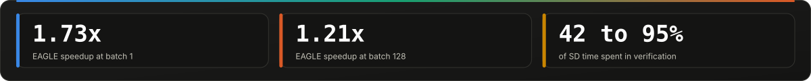</p>

<p align="center">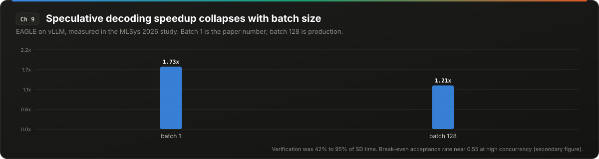</p>

> [!IMPORTANT]
> **At a glance.** EAGLE: 1.73x at batch 1, 1.21x at batch 128. Acceptance rate is a property of your traffic, not the model pair. Log it per segment and compute break-even.

### 9.1 The benchmark that does not transfer

Volume I explained speculative decoding (SD): a cheap drafter proposes *k* tokens, the target verifies them in one forward pass, and accepted tokens are free. The speedup is governed by the acceptance rate α and the draft length *k*, and the published numbers (2x to 3x) are real.

They were measured at batch size 1 to 4. The first systematic study of SD on a production engine (vLLM, MLSys 2026) covering n-gram, EAGLE/EAGLE-3, draft-model, and MTP variants across workloads and batch sizes found that the speedup collapses with batch size. EAGLE went from 1.73x at batch 1 to 1.21x at batch 128. Verification alone was 42% to 95% of total SD time depending on configuration.

The mechanism is the one Volume I used to motivate SD in the first place: at batch 1, decode is memory-bound, the target's weights are read once per step regardless of how many tokens are verified, and verifying *k*+1 tokens costs almost the same as generating one. At batch 128, decode is approaching compute-bound, every verified draft token costs real FLOPs, and rejected drafts are pure waste. SD converts spare compute into latency. When there is no spare compute, there is nothing to convert.

### 9.2 The break-even α

For a given concurrency, there is an acceptance rate below which SD is net negative. One production write-up puts it near α ≈ 0.55 at high concurrency for EAGLE-3 class drafters: below that, each rejected draft costs a second target pass that serializes under full batch, and mean inter-token latency improves while p99 gets worse. A common failure mode is a team that measures 2.5x at batch 1 in development, ships, and observes a 5% regression at a production p50 concurrency of 16.

α is not a property of the model pair. It is a property of the model pair on your traffic:

- **Position within a request.** Acceptance is high in the middle of a response and drops near the end, as the generation shifts toward conclusions and the drafter's priors weaken.
- **Task type.** Summarization and structured completion yield high α. Open-ended generation and multilingual output yield low α.
- **Language.** Chapter 21 covers this: draft models are small, small models have disproportionately weak multilingual ability, and α for non-English languages correlates with how well-resourced the language is. A 13-point α gap between the best and worst language was measured on the same model pair.
- **Reasoning.** Long chain-of-thought benefits most from drafters that maintain high acceptance over long context; MTP-based drafting is limited by reusing a single head across positions.

### 9.3 Chain versus tree

Tree-based drafters (multiple candidate continuations verified in one pass) lead slightly at batch size 1. Chain-style drafters are often stronger as batch size grows, because the tree's extra verification tokens are exactly the compute that high batch cannot spare.

### 9.4 Interactions with the rest of the engine

- **Chunked prefill.** Draft tokens are discarded during prefill chunks in vLLM. A request that is still being chunk-prefilled gets no speculation benefit, and the padding rule from Chapter 6 (`1 + k` slots per new decode) can block admission.
- **Prefix caching.** Draft tokens that are rejected are not cached; accepted ones are. This is fine. The problem is the drafter's own KV (for draft-model SD), which doubles the per-sequence memory footprint and competes with the target's cache.
- **Structured output.** Chapter 10.

### 9.5 The production recipe

1. Log α per traffic segment (per task, per language, per customer). It is the only metric that matters.
2. Re-measure at production concurrency, not at batch 1.
3. Compute the break-even α for your concurrency and set an automatic disable when the measured α falls below it. Goodput-based schedulers that adapt *k* per request (longer drafts for easy requests, zero for hard ones, off under saturation) exist and are the right design.
4. For outputs under roughly 50 tokens, do not bother; the fixed overhead dominates.
5. Prefer n-gram drafters for traffic where α is low anyway (multilingual, creative); they have lower α but near-zero draft cost, and in measurements they consistently deliver speedups where model drafters do not.

<details>
<summary><b>Sources</b></summary>

- "Speculative Decoding: Performance or Illusion?", MLSys 2026, arXiv 2601.11580: https://www.arxiv.org/pdf/2601.11580 (slides: https://mlsys.org/media/mlsys-2026/Slides/3782.pdf)
- Goodput-driven speculative decoding (adaptive *k*, auto-off under load), arXiv 2406.14066: https://arxiv.org/html/2406.14066v1
- "Speculative Decoding in Production: Free Tokens and Hidden Traps": https://tianpan.co/blog/2026-04-17-speculative-decoding-production-hidden-traps
- EAGLE-3 break-even α figure (tutorial, secondary; no primary measurement found): https://learn.traeai.com/t/ai-engineering/phases/17-infrastructure-and-production/05-eagle3-speculative-decoding
- BentoML speculative decoding rollout checklist: https://bentoml.com/llm/inference-optimization/speculative-decoding
- "The Disparate Impacts of Speculative Decoding" (language α gap), arXiv 2510.02128: https://arxiv.org/pdf/2510.02128


</details>

<p align="right"><a href="#contents">Back to contents</a></p>

---

## 10. Structured Output Meets Speculation: The Serial Path Nobody Benchmarks

<p align="center"></p>

<p align="center">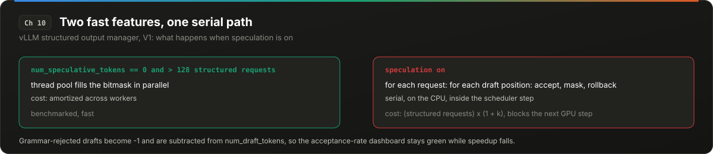</p>

> [!IMPORTANT]
> **At a glance.** Speculation plus grammar constraints falls back to a serial CPU loop inside the scheduler step. Grammar-rejected drafts leave the denominator, so the acceptance dashboard stays green.

### 10.1 Two features, each benchmarked alone

Grammar-constrained decoding (xgrammar, llguidance, Outlines) masks the logits at every step so that only tokens consistent with a JSON schema or regex can be sampled. Speculative decoding proposes several tokens at once. Each is benchmarked in isolation and each is fast. Together they take a code path that is neither.

### 10.2 What the source says

In vLLM's `StructuredOutputManager.grammar_bitmask` (V1, late 2026):

- The parallel bitmask fill (a thread pool computing masks for many requests at once) is used only when there are more than 128 structured requests in the batch **and** `num_speculative_tokens == 0`.
- With speculation on, the code falls back to a serial loop: for each request, for each draft position, advance the grammar matcher (`accept_tokens`), compute the mask, and then `rollback` the matcher to its pre-draft state. This runs inside the scheduler step, on the CPU, on the critical path.
- The bitmask is sized `max_num_seqs * (1 + k)` rows.

The per-step CPU cost is therefore proportional to (number of structured requests) × (1 + *k*), executed serially, and it blocks the next GPU step. At high concurrency with *k* = 4, the scheduler step becomes CPU-bound and GPU utilization drops in a way that neither feature's standalone benchmark predicts.

### 10.3 The metric that lies

Draft tokens that violate the grammar are replaced with `-1` and **subtracted from `num_draft_tokens`** before the acceptance rate is computed. A drafter proposing tokens the schema forbids is doing useless work, but the reported acceptance rate does not count those proposals as drafts at all. The dashboard shows a healthy α while the realized speedup falls, because every grammar-rejected draft still cost a draft step and a mask computation.

The same class of problem has been reported at the output level: when SD is combined with reasoning parsers and schema constraints, tokens have been observed to drop silently during batch verification, producing output that is schema-valid but missing content.

### 10.4 Grammar compilation

Grammar compilation is asynchronous on a thread pool of `(cpu_count + 1) // 2` workers, and is forced synchronous under the external launcher. No published measurement of compilation stall times was found for this handbook. One concrete data point: the xgrammar compile cache was unbounded in vLLM 0.6.5 through 0.8.3, which was a denial-of-service vector (GHSA-hf3c-wxg2-49q9): unique schemas per request filled host memory.

### 10.5 What to do

1. Benchmark the combination, at production concurrency, with your real schemas.
2. If you must have both, cap *k* low (1 or 2) for structured requests, or route structured requests to a pool with speculation off.
3. Report α computed from raw draft proposals, before grammar filtering, as a separate metric.
4. Canonicalize schemas so the compile cache hits; bound the cache.
5. For Arabic strings inside JSON, see Chapter 20 on escaping, which interacts with the grammar's token set in ways that have not been measured publicly.

<details>
<summary><b>Sources</b></summary>

- vLLM structured output manager source: https://github.com/vllm-project/vllm/blob/main/vllm/v1/structured_output/__init__.py
- vLLM V1 scheduler source (draft handling): https://github.com/vllm-project/vllm/blob/main/vllm/v1/core/sched/scheduler.py
- xgrammar compile cache advisory GHSA-hf3c-wxg2-49q9
- Silent token drops under SD plus structured output (practitioner report): https://tianpan.co/blog/2026-04-17-speculative-decoding-production-hidden-traps


</details>

<p align="right"><a href="#contents">Back to contents</a></p>

---

# Part III: The Host and Hardware Path

<p align="center">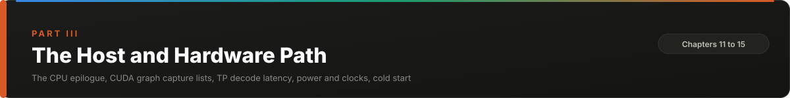</p>

## 11. The CPU Side: Sampling, Detokenization, and the API Server

<p align="center">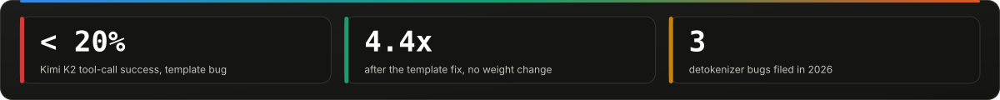</p>

<p align="center">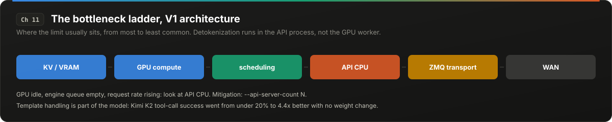</p>

> [!IMPORTANT]
> **At a glance.** Detokenization runs in the API process, not the GPU worker. Three 2026 bugs leak prompts or emit U+FFFD mid-character. Kimi K2 tool calls were under 20% because of template handling.

### 11.1 The forgotten half of the iteration

An inference step is a GPU forward pass followed by a CPU-side epilogue: sample a token from the logits, detokenize it, package it into a stream event, and schedule the next step. Three years of optimization went into the forward pass. The epilogue is still largely a serial Python path, and in several configurations it is now the bottleneck.

### 11.2 Sampling as a decision plane

Sampling (temperature scaling, top-k, top-p, softmax, draw) runs once per sequence per step. It is parallel-unfriendly: top-k needs a partial sort, top-p needs a prefix sum over a sorted distribution, and both operate on a vocabulary of 128k to 260k entries per sequence. In single-GPU serving it is a few percent of step time. In tensor- or pipeline-parallel serving, where the forward pass is split across devices but sampling remains a serial epilogue on one of them, it occupies a growing fraction of iteration time as the data plane gets faster.

One 2025 system (SIMPLE) disaggregates sampling into a CPU-side service that overlaps with the next forward pass. Reported results: up to 96% higher end-to-end throughput and up to 65% lower p95 latency, with the GPU residency attributable to sampling reduced to a minor role. The size of the gain is the size of the problem it exposes.

The cheaper mitigations: use greedy decoding (`temperature=0`) where the product allows; avoid top-p where top-k suffices (top-p requires the sort, top-k requires only a partial selection); and batch sampling across sequences on the GPU rather than per-sequence on the host.

### 11.3 Detokenization lives on the API side

In vLLM's V1 architecture, detokenization runs in the API server process, not the GPU worker, deliberately: the worker stays numeric and the API process assembles the stream protocol. The bottleneck ordering documented for that architecture is:

```
KV / VRAM  >  GPU compute  >  scheduling  >  API CPU  >  ZMQ transport  >  WAN
```

API CPU becomes the limit under very high QPS, many concurrent streaming connections, or multimodal inputs. The mitigation is `--api-server-count N`, which runs multiple API processes in front of one engine. If you observe GPU utilization dropping while request rate rises, and the engine's own queue is empty, this is where to look.

### 11.4 Incremental detokenization bugs

Streaming requires emitting text as tokens arrive, but a token is not always a whole character. BPE vocabularies contain tokens that are partial UTF-8 sequences; the character completes only when the next token arrives. The incremental detokenizer must hold back bytes until a valid boundary. Three open or recently fixed bugs in this path (all from 2026):

- **vLLM #48853.** `FastIncrementalDetokenizer` leaks the entire prompt into the first streamed delta when the prompt's token array ends mid-character. Reported as affecting 0.25.1 onward; a fix PR exists, merge status not confirmed at time of writing.
- **vLLM #59089.** Non-streaming endpoints append a spurious U+FFFD replacement character when generation stops mid-character: observed in 6 of 70 chat and 8 of 69 completion responses in the reporter's test.
- **Dynamo #12630.** The Dynamo frontend corrupted 10 to 13 characters on a prompt where SGLang direct corrupted none. Fixed in the Python path.

These bugs are reported with emoji, Thai, and Korean. Chapter 21 shows they apply to Arabic in a tokenizer-specific way: Qwen splits tanween marks across two tokens, so a naive per-token decoder emits a replacement character roughly once every 12 words of diacritized text.

### 11.5 Tokenizer and template bugs that look like model quality

The highest-leverage item in this chapter is the hardest to detect. vLLM's Kimi K2 case study is the canonical example: tool-call success was **below 20%** because the engine dropped `add_generation_prompt` (it was hidden in `**kwargs` and not forwarded to the template) and turned empty content into a list literal. Fixing the template handling gave a 4.4x improvement in tool-call accuracy. Nothing in the model changed. Every eval that bypassed the serving template passed.

The pattern: the model's quality is a function of (weights, tokenizer, template, engine's template handling). Public evals test the first two. Your deployment runs all four.

### 11.6 Tokenization itself

The BPE merge stage is compatible with streaming input and can be made incremental with worst-case `O(n log² t)` guarantees (ICML 2026), yielding up to 3x over HuggingFace tokenizers and large gains over tiktoken on pathological inputs. The remaining offline stages, normalization and regex pre-tokenization, are documented as the next computational bottleneck. For prompts of 68k tokens (the Copilot median, Chapter 7), server-side tokenization is inside the TTFT clock and is not free.

### 11.7 What to do

1. Run the engine's template through `/render` with a real multi-turn, multi-tool conversation and diff against the model author's reference rendering, token by token.
2. Test streaming with text that ends mid-character (truncate with `max_tokens` at odd positions) in every script you serve.
3. Monitor API-process CPU separately from engine CPU.
4. Prefer greedy or top-k over top-p where the product permits.

<details>
<summary><b>Sources</b></summary>

- SIMPLE: disaggregating sampling, arXiv 2512.00719: https://arxiv.org/html/2512.00719v1
- vLLM V1 architecture overview (API-side detokenization): https://docs.vllm.ai/en/latest/design/arch_overview/
- vLLM V1 output processor source (detokenizer runs in the frontend process): https://github.com/vllm-project/vllm/blob/main/vllm/v1/engine/output_processor.py
- Bottleneck ordering (secondary walkthrough): https://www.besthub.dev/articles/how-vllm-generates-tokens-a-deep-dive-into-the-source-code-450de50f031c
- vLLM issue 48853: https://github.com/vllm-project/vllm/issues/48853
- vLLM issue 59089: https://github.com/vllm-project/vllm/issues/59089
- Dynamo issue 12630: https://github.com/ai-dynamo/dynamo/issues/12630
- vLLM, Kimi K2 accuracy case study: https://vllm.ai/blog/2025-10-28-kimi-k2-accuracy
- Incremental BPE tokenization, ICML 2026, arXiv 2605.30813: https://arxiv.org/pdf/2605.30813


</details>

<p align="right"><a href="#contents">Back to contents</a></p>

---

## 12. The Launch Floor: CUDA Graph Capture Lists and the Framework Tax

<p align="center">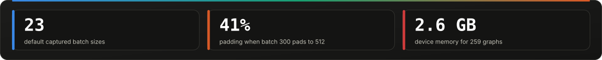</p>

<p align="center">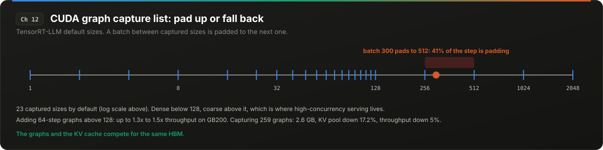</p>

> [!IMPORTANT]
> **At a glance.** 23 default graph sizes; a batch of 300 pads to 512 and 41% of the step is padding. Capturing 259 graphs cost 2.6 GB and 17.2% of the KV pool.

### 12.1 Three components of host overhead

A trace-driven decomposition (TaxBreak, 2026) splits host-visible orchestration overhead into three parts: **framework execution** (Python-level dispatch, shape inference, tensor allocation), **CUDA library front-end** (cuBLAS, cuDNN, FlashInfer entry points choosing kernels), and **kernel launch** (the driver call that enqueues work). For large models with large batches, all three hide behind GPU execution. For small models, small batches, or MoE models with many small expert kernels per layer, they do not, and decode time becomes a function of how many kernels you launch rather than how much data you move.

### 12.2 What CUDA graphs fix and what they do not

CUDA graphs capture a sequence of kernel launches once and replay them with one driver call, removing per-kernel launch latency and most framework dispatch. They are the standard mitigation and they work. Two limits:

**The device-occupancy floor.** Every kernel holds the device for some minimum time regardless of how little data it touches. Graph capture eliminates the launch gap between kernels; it does not eliminate the kernel's own minimum runtime. For a small model, the sum of these minimums across 100+ kernels per layer is a decode-latency floor that no optimization reaches. Simulators that model inference performance expose this as a separate parameter from launch latency precisely because it survives graph capture.

**Dynamic shapes.** A graph is captured for a fixed batch size. Serving a batch size that was not captured means either padding up to the next captured size (wasting compute on padding rows) or falling back to eager execution (paying the launch tax). The capture list is therefore a tuning parameter with real consequences.

### 12.3 The capture list is not free

TensorRT-LLM's default captures 23 batch sizes: 1, 2, 4, then steps of 8 up to 128, then 256, 512, 1024, 2048. A batch of 300 is padded to 512; at that concurrency, 41% of the forward pass is padding. On GB200 with NVFP4 models, adding 64-step graphs above 128 produced up to 1.3x aggregated throughput and up to 1.5x disaggregated throughput for DeepSeek-R1 at concurrency 500 to 600, at roughly 10 MB of device memory per captured graph.

Overcorrecting fails the other way. Capturing at 8-step granularity all the way up (259 graphs) cost 2.6 GB of device memory, which reduced the KV cache pool by 17.2% on DeepSeek-V3.2 and produced a 5% throughput regression. The graphs compete with the cache for the same HBM.

The capture mode (none / piecewise / full) also matters: piecewise capture (graph for the non-attention parts, eager attention) tolerates dynamic sequence lengths but reintroduces launch overhead around attention; full capture is fastest but needs a captured shape for every (batch, length bucket) combination.

### 12.4 Python in the router

A secondary report describes SGLang's router hitting scaling limits above roughly 150 concurrent requests because of the Python GIL. That description predates the current router, which is written in Rust (sgl-router) precisely to remove this limit, so treat the number as a property of the old Python path. vLLM addresses the same problem with multiple API processes (Chapter 11). In both cases the symptom is the same: the GPU is idle and the request queue is non-empty, because the host cannot feed it.

### 12.5 What to do

1. Histogram your production batch sizes over a day. Capture graphs at the modes of that histogram, not at the framework default.
2. Account for graph memory in KV cache sizing. Log the pool size at startup before and after capture.
3. For MoE models, measure launch overhead explicitly; the expert kernels are many and small.
4. For small models (under roughly 4B parameters), accept the floor and size latency SLOs to it.

<details>
<summary><b>Sources</b></summary>

- TaxBreak: overhead decomposition, arXiv 2603.12465: https://arxiv.org/pdf/2603.12465
- NVIDIA TensorRT-LLM, "Tuning CUDA Graph Batch Sizes for Higher Output Throughput": https://nvidia.github.io/TensorRT-LLM/blogs/tech_blog/blog20_Tuning_CUDA_Graph_Batch_Sizes_for_Higher_Output_Throughput.html
- AMD Infera modeled features (occupancy floor as a separate parameter from launch latency): https://rocm.docs.amd.com/projects/infera/en/latest/_sources/simulation/modeled_features.md
- SGLang router GIL limit (secondary, describes the pre-Rust router): https://fish.audio/blog/open-source-llm-inference-engines-2026/
- SGLang Rust router: https://github.com/sgl-project/sglang/tree/main/sgl-router


</details>

<p align="right"><a href="#contents">Back to contents</a></p>

---

## 13. Tensor Parallel Decode Is a Latency Problem, Not a Bandwidth Problem

<p align="center">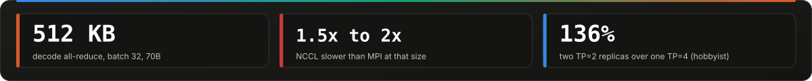</p>

<p align="center">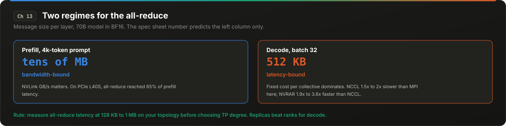</p>

> [!IMPORTANT]
> **At a glance.** Decode all-reduce messages are 128 KB to 1 MB: latency-bound, not bandwidth-bound. NCCL is 1.5x to 2x slower than MPI there. Measure before choosing TP degree.

### 13.1 Two regimes

Volume I covered tensor parallelism (TP) and the rule of thumb that it needs NVLink. The reason usually given is bandwidth: each layer ends in an all-reduce over the hidden dimension, and 80 layers times 2 all-reduces is 160 collective operations per token. That reasoning is right for prefill and wrong for decode.

In prefill, the all-reduce message is (prompt tokens × hidden size): for a 4k-token prompt on a 70B model, tens of megabytes. Bandwidth dominates. On PCIe-connected L40S GPUs, all-reduce has been measured at up to 65% of prefill latency against roughly 20% on NVLink A100s.

In decode, the message is (batch size × hidden size): for batch 32 on a 70B model in BF16, about 512 KB. The regime is 128 KB to 1 MB. At those sizes, latency dominates: the fixed cost of initiating the collective, synchronizing ranks, and traversing the interconnect, which is nearly independent of bytes. NCCL is tuned for large messages. Measurements across nodes found NCCL 1.5x to 2x slower than MPI implementations in this small-message regime. At 32 GPUs, communication exceeded 50% of both prefill and decode time.

### 13.2 What a small-message all-reduce buys

A replacement all-reduce designed for the decode regime (NVRAR, 2025) reported 1.9x to 3.6x lower latency than NCCL for these message sizes, which translated to 1.72x lower batch latency for Llama-3.1-405B. The gain is available because NCCL's algorithm selection assumes bandwidth is the constraint.

The practical implication for anyone sizing an interconnect: the GB/s number on the spec sheet predicts prefill. The microsecond latency of a 256 KB all-reduce across your topology predicts decode, and it is rarely published. Measure it with `nccl-tests` at the message sizes your batch actually produces.

### 13.3 Topology over TP degree

A consequence that shows up on commodity hardware: on a 4-GPU PCIe 3.0 box, two TP=2 replicas outperformed one TP=4 deployment by 136% (1,437 against 610 tokens/s at concurrency 128). Halving the TP degree halves the ranks in every collective and doubles the independent replicas. This is a hobbyist measurement (one repo, consumer GPUs) and should be weighted accordingly, but the direction is consistent with the latency argument: more ranks in a small-message collective cost more than they save.

A related failure: vLLM's custom all-reduce has been reported to hang at worker initialization on PCIe-only multi-NUMA Blackwell systems unless `--disable-custom-all-reduce` is set. The root cause was not confirmed in the thread. The symptom (hang at init, not at runtime) is distinctive.

### 13.4 Data parallelism for decode, tensor parallelism for prefill

Disaggregated deployments (Volume I, Chapter 16) already let the two pools use different parallelism. The argument here sharpens the recommendation: the decode pool should use the smallest TP that fits the weights, and scale by replicas (data parallel), while the prefill pool can use higher TP because its messages are large enough for bandwidth to dominate. DeepSeek's disclosed configuration (Chapter 16) is the counterexample worth understanding: its decode pool uses more parallelism than prefill (EP144 on 18 nodes against EP32 on 4), because for a large MoE the goal in decode is to spread experts thinly so each GPU holds few experts and serves a huge batch per expert. The all-to-all in expert parallelism is a different collective from TP's all-reduce, and the small-message latency argument above applies to it too; DeepSeek absorbs it with custom communication kernels and dual-microbatch overlap. The recommendation here is for dense models under TP.

### 13.5 What to do

1. Measure all-reduce latency at 128 KB to 1 MB on your topology before choosing TP degree.
2. Prefer replicas over TP degree for the decode pool whenever the weights fit.
3. On PCIe systems, consider TP=2 as the ceiling and compare against TP=1 with quantized weights.
4. If a TP deployment hangs at init on new hardware, try disabling the custom all-reduce before anything else.

<details>
<summary><b>Sources</b></summary>

- NVRAR small-message all-reduce, arXiv 2511.09557: https://arxiv.org/abs/2511.09557
- "Beyond NCCL" (NCCL versus MPI in the small-message regime): https://pssg.cs.umd.edu/blog/2025/beyond-nccl/
- All-reduce share of prefill latency, PCIe versus NVLink, arXiv 2412.04964: https://arxiv.org/html/2412.04964v1
- TP topology benchmark on consumer GPUs (hobbyist, not primary): https://github.com/mtecnic/vllm-topology-bench
- vLLM custom all-reduce hang on Blackwell PCIe (forum, root cause unconfirmed): https://discuss.vllm.ai/t/vllm-hangs-during-worker-initialization-on-blackwell-pcie-gpus-unless-disable-custom-all-reduce-is-used/2540


</details>

<p align="right"><a href="#contents">Back to contents</a></p>

---

## 14. Power, Clocks, and Co-Tenant Contention

<p align="center">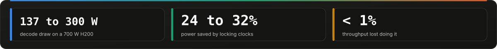</p>

<p align="center">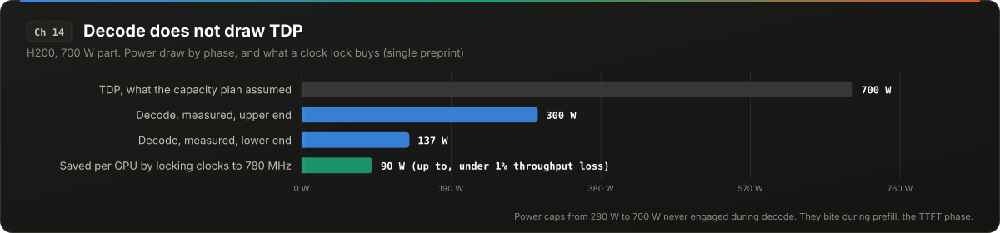</p>

> [!IMPORTANT]
> **At a glance.** Decode draws 137 to 300 W of a 700 W H200. Power caps never engage during decode. Locking clocks saved 24% to 32% at under 1% throughput loss.

### 14.1 Power caps do not engage during decode

Capacity planners budget GPU power at TDP (700 W for an H200). A power cap is a ceiling; the GPU draws what the workload needs up to that ceiling. One 2026 study (single preprint, not independently reproduced) measured decode drawing only 137 to 300 W on a 700 W H200, because decode is memory-bound and the SMs are mostly idle waiting on HBM. Caps from 280 W to 700 W never engaged; the SM clock stayed at roughly 1830 MHz throughout.

Two consequences. First, decode power is roughly 20% to 40% of TDP, so a decode-heavy fleet planned at TDP overstates power and cooling by 2x to 5x. Second, a power cap only bites during prefill, where it reduces throughput on the phase that is already the TTFT bottleneck.

The same study found that **locking the clock** rather than capping power is the effective lever: locking to 780 MHz saved 47 to 90 W per GPU (24% to 32%) at under 1% throughput loss during decode, because a memory-bound workload does not need fast SMs. One trap: `--lock-gpu-clocks` requests at or above the boost ceiling (about 1830 MHz on that part) are silently clamped, and the attempt costs 7% to 13% more power for zero gain.

### 14.2 Thermal throttling

No primary source with throughput numbers for thermal throttling on inference was found for this handbook. The Ampere memory-error study found only weak correlation between temperature and memory errors (coefficients 0.011 to 0.32). The honest statement is that thermal throttling is a real mechanism with no published inference-specific measurement; if your fleet runs hot, measure it yourself by logging `clocks.sm` alongside tokens/s.

### 14.3 Intra-GPU contention survives SM partitioning

Multi-tenancy on one GPU (MIG, MPS, time-slicing, or simply colocating prefill and decode) is usually reasoned about in terms of SM allocation. Two resources are shared regardless of SM partitioning: HBM bandwidth and the block scheduler.

Measurements with synthetic co-tenant kernels on an H100: Llama-3.1-8B decode p90 time-between-tokens went from 14.2 ms to 22 ms (1.55x) as the co-tenant's memory-bandwidth use reached 81%, and 2.2x under register-induced head-of-line blocking in the block scheduler. The co-tenant was synthetic, not a real prefill workload, so the exact numbers are illustrative; the mechanism is that a bandwidth-bound decode shares the bandwidth with whatever else is on the chip, and SM isolation does not isolate bandwidth.

This is the physical argument behind disaggregation (Volume I, Chapter 16) stated at the hardware level: prefill and decode on one GPU contend for HBM bandwidth even when the scheduler interleaves them perfectly.

### 14.4 What to do

1. Measure actual decode power on your hardware. Plan cooling and power on measured draw plus margin, not TDP.
2. Experiment with locked clocks on decode pools. Do not request a lock above the boost ceiling.
3. If you must colocate on one GPU, measure bandwidth contention directly (p90 TBT with and without the co-tenant) rather than reasoning from SM shares.

<details>
<summary><b>Sources</b></summary>

- Power capping versus clock locking on H200 decode, arXiv 2605.11999 (preprint, single source): https://arxiv.org/html/2605.11999v1
- Intra-GPU contention measurements, arXiv 2501.16909: https://arxiv.org/pdf/2501.16909
- Ampere memory errors and temperature, arXiv 2508.03513: https://arxiv.org/html/2508.03513v2


</details>

<p align="right"><a href="#contents">Back to contents</a></p>

---

## 15. Cold Start Is CPU-Bound

<p align="center">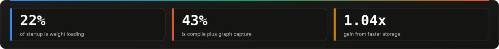</p>

<p align="center">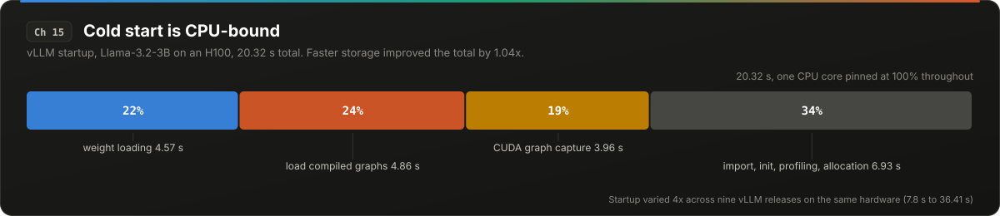</p>

> [!IMPORTANT]
> **At a glance.** Weights are 22% of a 20 s startup; compile and graph capture are 43%. Faster storage improved startup 1.04x. Fleet-scale cold start: 10 minutes local, 2 hours cross-region.

### 15.1 Where the 20 seconds go

A study of vLLM startup (Llama3.2-3B on an H100, 20.32 s total) decomposed the time:

| Phase | Time | Share |
|---|---|---|
| Weight loading | 4.57 s | 22% |
| Loading compiled graphs | 4.86 s | |
| CUDA graph capture | 3.96 s | |
| Everything else (import, init, profiling, allocation) | remainder | |

Compile and capture together (8.82 s, 43%) exceed weight loading (4.57 s, 22%). At least one CPU core was pinned at 100% for the entire startup. Moving weights to faster storage improved total startup by 1.04x. A faster GPU gave almost no improvement. Startup varied 4x across nine vLLM releases (7.8 s to 36.41 s) with the same model and hardware.

The caveat: the 22% weight share is for a 3B model. Weight time scales linearly with parameters, so for a 70B model it is a larger share. The compile and capture time scales with model depth and the capture list (Chapter 12), not with parameter count, so for large models the two are comparable.

### 15.2 What this means for autoscaling

The standard investment in cold start is weight streaming: safetensors, NVMe, pre-pulled images, peer-to-peer weight distribution. Those address roughly one fifth of the time. The remaining four fifths is mostly single-threaded CPU work that does not parallelize across GPUs and does not benefit from faster storage.

At fleet scale the numbers are worse. Microsoft's O365 serving (roughly 10M requests per day) reported instance cold start of about 10 minutes with the model local and about 2 hours when weights had to come from another region. The autoscaler fix that followed cut wasted GPU-hours by 80%, valued at up to $2.5M per month. The lag between "scale up" and "serving" is the dominant cost of autoscaling, and it is measured in minutes, not seconds.

### 15.3 What to do

1. Profile startup once. If compile and capture dominate, cache the compiled artifacts (vLLM supports this) and pin the capture list.
2. Keep warm standby instances sized to the autoscaler's reaction lag, not to average load. Compute the lag from measured cold start, not from weight size.
3. Treat framework upgrades as a cold-start regression risk; measure startup in CI.
4. Pin one fast CPU core per engine process for startup; do not run startup on a CPU-constrained pod.

<details>
<summary><b>Sources</b></summary>

- vLLM cold start study, arXiv 2606.07362: https://arxiv.org/pdf/2606.07362
- Microsoft SageServe (O365 cold start and autoscaler savings), arXiv 2502.14617: https://arxiv.org/html/2502.14617v3


</details>

<p align="right"><a href="#contents">Back to contents</a></p>

---

# Part IV: Fleet Realities

<p align="center">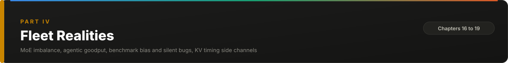</p>

## 16. MoE Expert Imbalance and the DeepSeek Disclosure

<p align="center">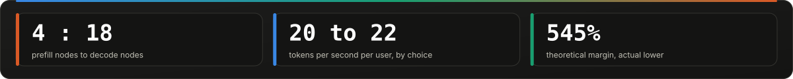</p>

<p align="center">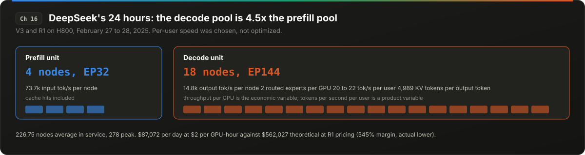</p>

> [!IMPORTANT]
> **At a glance.** DeepSeek ran 4 prefill nodes against 18 decode nodes and chose 20 to 22 tokens/s per user. $87k per day of GPU against $562k theoretical revenue.

### 16.1 The router is balanced in training, not in serving

Volume I covered expert parallelism (EP) for MoE inference: each GPU holds a subset of experts, and tokens are routed to the GPUs that hold their selected experts. The throughput of a step is set by the most-loaded GPU. Any imbalance in how many tokens each expert receives is directly lost throughput on every other GPU.

Routers are trained with auxiliary losses to balance expert load on the training distribution. Serving traffic is not the training distribution. Measured expert popularity during inference is skewed, and the skew is not static: it changes batch to batch, and under continuous batching the hot experts shift within a single long decode (measurements show popularity changing noticeably over roughly 8k tokens of generation). Solutions based on offline profiling and periodic re-placement (replicate the popular experts, rebalance every few minutes) do not keep up; one study showed a profiling-based system failing to adapt under dynamically fluctuating skew.

The design space, with reported gains:

- **Dynamic token redistribution plus asynchronous expert prefetching** (HarMoEny): 37% to 70% higher throughput and 34% to 41% lower TTFT under heavy imbalance versus the next-best baseline; GPU idle time reduced up to 84%.
- **Expert sharding instead of expert placement** (MoESHARD): tensor-shard every expert across all GPUs so every token touches every GPU equally. Perfect balance by construction; the cost is more collective communication per layer.
- **Predictive prefetching** (PROBE): predict next-step expert demand and overlap the weight movement with compute.
- **Redundant hot experts** (DeepSeek's EPLB): replicate the experts the router currently favors, chosen from live statistics, so that no GPU is the straggler.

### 16.2 DeepSeek's 24 hours

The most detailed public disclosure of a production MoE deployment is DeepSeek's inference system overview for February 27 to 28, 2025 (V3 and R1 on H800):

- **Prefill unit:** 4 nodes, EP32. **Decode unit:** 18 nodes, EP144. The two phases are not 1:1; decode has 4.5x the nodes.
- Per H800 node: 73.7k input tokens/s prefill (cache hits included), 14.8k output tokens/s decode.
- **Per-user output speed: 20 to 22 tokens/s.** Average KV cache length per output token: 4,989 tokens.
- Average 226.75 nodes in service against a peak of 278. Night-time capacity is reassigned (the document describes moving nodes to research and training during low traffic; this detail was not re-verified for this handbook).
- Cost: $87,072/day at $2 per GPU-hour. Theoretical revenue at R1 pricing: $562,027/day, a 545% margin. DeepSeek states actual revenue is substantially lower because V3 is priced lower, web and app traffic is free, and night-time discounts apply.
- Decode runs 2 routed experts per GPU, which maximizes batch per expert at the cost of per-user speed.

The lesson is not the margin. It is that the fastest-growing API provider of that year chose **slow per-user decode (20 tok/s) and huge batches** over the per-user speed that benchmarks optimize for. Throughput per GPU is the economic variable; tokens/s per user is a product variable, and they are set independently.

No EP=320 configuration was found in the disclosure; EP32 and EP144 are the documented values.

### 16.3 What to do

1. Instrument per-expert token counts per step. The imbalance metric is (max GPU tokens / mean GPU tokens); above 1.3 you are losing a quarter of your throughput.
2. Replicate hot experts from live statistics, not from an offline profile.
3. For the decode pool, size batch per expert, not batch per GPU.
4. Decide per-user tokens/s as a product requirement, then derive the EP configuration; do not let the benchmark default decide it.

<details>
<summary><b>Sources</b></summary>

- DeepSeek-V3/R1 inference system overview: https://github.com/deepseek-ai/open-infra-index/blob/main/202502OpenSourceWeek/day_6_one_more_thing_deepseekV3R1_inference_system_overview.md
- HarMoEny, arXiv 2506.12417: https://arxiv.org/pdf/2506.12417
- MoESHARD (expert sharding), arXiv 2503.08467: https://arxiv.org/pdf/2503.08467
- PROBE (predictive prefetching, temporal volatility measurements), arXiv 2602.00509: https://arxiv.org/html/2602.00509v1
- Dynamic expert duplication (MoE-GPS), NeurIPS 2025 ML for Systems: https://mlforsystems.org/assets/papers/neurips2025/paper19.pdf


</details>

<p align="right"><a href="#contents">Back to contents</a></p>

---

## 17. Agentic Workloads: Goodput, Sticky Routing, and the Turn Boundary

<p align="center"></p>

<p align="center">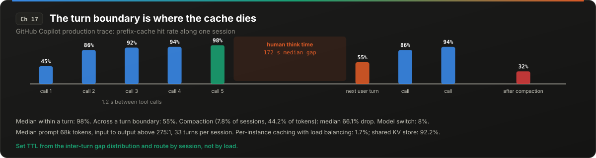</p>

> [!IMPORTANT]
> **At a glance.** Per-instance caching behind a load balancer: 1.7% hit rate on Codex traces. Shared KV store: 92.2%. Queue wait reaches 58% of program delay.

### 17.1 A new workload shape

Volume I's goodput chapter assumed a request is a prompt, a generation, and a response. An agent is a program: dozens of LLM calls separated by tool executions, each call reusing most of the previous context plus a tool result. The Copilot trace (Chapter 7) has a median of 33 turns per session, an input-to-output ratio above 275:1, and a median prompt of 68k tokens. Codex/SWE-bench Pro traces have a median inter-call gap of 5.2 seconds and a p99 of 81.4 seconds.

Three consequences for serving:

**Prefill dominates.** At 275:1, the decode phase is almost irrelevant to cost. Everything Volume I said about decode optimization matters less; everything about prefix caching and prefill scheduling matters more.

**The cache must survive the gap.** Tool execution takes seconds; human review takes minutes. The KV for a 68k prefix must stay resident across both or the next call re-prefills 68k tokens.

**Latency is cumulative.** A user waits for the whole program. Thirty calls at 1 second of queue wait each is 30 seconds of dead time.

### 17.2 Per-instance caching gets 1.7%

On 610 Codex/SWE-bench Pro traces replayed through a multi-instance vLLM deployment with per-instance prefix caching and standard load balancing, the measured hit rate was **1.7%**. Consecutive calls of the same session were routed to different instances (the load balancer saw them as independent requests), and when they did land on the same instance, the prefix had been evicted during the tool pause.

The same traces with a shared KV store (Mooncake Store behind vLLM): **92.2%** hit rate, 3.8x throughput, 46x lower p50 TTFT.

The lesson vLLM's own write-up draws: session-aware sticky routing beats load balancing for agentic traffic. The load balancer's objective (equalize queue depth) is directly opposed to the cache's objective (keep a session on the instance that holds its prefix).

### 17.3 Queue wait is most of the latency

Continuum (2025) measured that queue waiting between tool calls can reach **58.2% of total program delay**. The scheduler treats each call as a new arrival with no priority, so a session that is 25 calls in waits behind fresh single-turn requests. Session-aware scheduling (reserve KV for an in-flight session during tool execution, prioritize its next call) is the fix, and it conflicts with FCFS fairness in a way that must be decided as policy.

### 17.4 Measuring goodput for programs

The per-request metrics (TTFT, TPOT) are the wrong unit. AgentX (vLLM and SemiAnalysis, 2026) proposes a benchmark that replays recorded inter-call gaps and scores throughput at a p90 interactivity floor: the fleet gets credit for tokens only if the session's p90 call latency is under the floor. Under that metric, setting `long_prefill_token_threshold` (Chapter 6) produced up to 93% more tokens per GPU-second and roughly 2.3x better p90 interactivity.

### 17.5 The turn boundary

Returning to the Copilot numbers: 98% within a turn, 55% across a turn boundary. The within-turn number is produced by tool loops with 1.2-second gaps; the cross-turn number is produced by 172-second human gaps against an eviction TTL shorter than that. Compaction (7.8% of sessions, 44.2% of tokens, median 66.1% hit-rate drop) and model switches (8% average hit rate) are the other two cold events.

An agentic serving fleet should therefore have three TTL regimes: seconds for tool loops (cheap, any instance), minutes for human turns (needs tiered storage or sticky routing with reservation), and explicit invalidation for compaction and model switches (schedule them off the critical path).

### 17.6 What to do

1. Route by session ID, with the prefix location as the routing key.
2. Set KV TTL from the measured inter-turn gap distribution, with tiered offload (Volume I, Chapter 10) for the minutes regime.
3. Report session-level p90 latency, not request-level.
4. Set `long_prefill_token_threshold`.
5. Reserve KV for in-flight sessions during tool execution and prioritize their return.

<details>
<summary><b>Sources</b></summary>

- vLLM, Mooncake Store integration (1.7% to 92.2% on Codex traces): https://vllm.ai/blog/2026-05-06-mooncake-store
- Continuum (queue wait share of program delay), arXiv 2511.02230: https://arxiv.org/abs/2511.02230
- SemiAnalysis InferenceX agentic benchmark guide: https://inferencex.semianalysis.com/blog/agentic-benchmark-agent-benchmark-guide
- vLLM AgentX: https://vllm.ai/blog/2026-09-08-vllm-agentx
- Microsoft Research Copilot traces: https://www.microsoft.com/en-us/research/wp-content/uploads/2026/08/ghcp_traces-6.pdf


</details>

<p align="right"><a href="#contents">Back to contents</a></p>

---

## 18. Benchmarks That Overstate Capacity and Bugs That Pass Evals

<p align="center"></p>

<p align="center">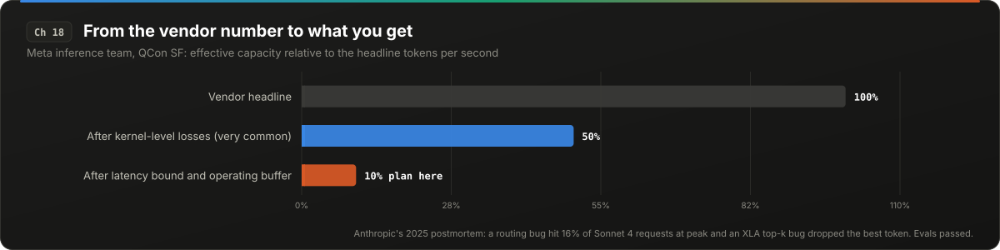</p>

> [!IMPORTANT]
> **At a glance.** Plan for one tenth of the vendor tokens/s. Anthropic's routing bug hit 16% of requests at peak and an XLA top-k bug dropped the best token. Evals passed.

### 18.1 The 10x

Meta's inference team (QCon SF, Nov 2024; published May 2025) stated that it is "very common to lose 50% effective FLOPS, even at the earliest kernel benchmarking stage," and that after "combining the latency bound and some operating buffer, you're going to lose 10x" relative to the headline number. A vendor tokens/s figure, multiplied by price, is not a cost per token; it is an upper bound on a quantity you will reach one tenth of.

Two related Meta figures: prefill/decode disaggregation commonly adds 50 to 100 ms to TTFT from KV transfer (a cost Volume I's disaggregation chapter noted qualitatively), and the long tail of small-traffic deployments (one model per internal product) can collectively consume more GPUs than the main model.

### 18.2 Benchmark bias is systemic

SemiAnalysis's InferenceX methodology page states that participants "often submit software images purpose-built for the benchmark itself which do not reflect real world performance." Its earlier AMD-versus-NVIDIA study found 25% of tested models failing accuracy tests on ROCm, which means a throughput number for those configurations was a number for producing wrong tokens quickly. A 2026 paper on systemic measurement bias in production LLM benchmarks documents that the load generators themselves (closed-loop versus open-loop arrival, request-length distributions, warmup handling) shift results enough to change engine rankings.

Specific numbers that circulate without their conditions: llm-d's "57x TTFT improvement" (0.542 s against 31 s p90) is from a synthetic 150-tenant workload at 73% cache pressure, which is a real result for that scenario and not a fleet expectation.

### 18.3 Silent correctness bugs

Anthropic's postmortem of three production issues (September 2025) is the most detailed public account of inference bugs that passed evals:

- **Context-window misrouting.** Starting August 5, 0.8% of Sonnet 4 requests were routed to servers configured for a different context window. A load-balancing change on August 29 raised it to 16% of requests at the worst hour on August 31. Because routing is sticky (a session stays on the server it first hit), roughly 30% of Claude Code users active in the period had at least one misrouted message. The bug was in infrastructure, not the model; benchmark evals of the model were unaffected.
- **Output corruption** from a misconfigured runtime that occasionally produced wrong-language characters or syntax errors.
- **The XLA:TPU top-k bug.** A compiler bug involving mixed bf16/fp32 precision and an approximate top-k operation sometimes dropped the highest-probability token. It occurred "only for certain batch sizes and model configurations," and its behavior changed when debugging tools were enabled, which is the signature of a numerics bug that depends on kernel selection (Chapter 1's mechanism, surfacing as a correctness failure).

The remediation Anthropic described: continuous evals on true production systems (not on a separate eval path), and more sensitive evals. Fireworks' KL-divergence gate (Chapter 4) is the same idea applied to quantization: a metric sensitive enough to see distribution shifts that argmax benchmarks miss.

### 18.4 What to do

1. Divide every vendor throughput number by 5 to 10 before planning.
2. Run accuracy checks inside every throughput benchmark. A fast wrong answer is not throughput.
3. Run a canary eval on the production serving path, continuously, with the production template, production routing, and production batch sizes.
4. Keep a per-server output-hash canary (Chapter 5). Sticky routing means a bad server affects a consistent subset of users for weeks.
5. Record load-generator type (open versus closed loop), arrival distribution, and warmup in every benchmark result.

<details>
<summary><b>Sources</b></summary>

- Meta inference talk, InfoQ: https://www.infoq.com/presentations/llm-meta
- SemiAnalysis InferenceX methodology: https://inferencex.semianalysis.com/about
- SemiAnalysis AMD versus NVIDIA inference study: https://newsletter.semianalysis.com/p/amd-vs-nvidia-inference-benchmark-who-wins-performance-cost-per-million-tokens
- Systemic measurement bias in production LLM benchmarks, arXiv 2605.24217: https://arxiv.org/pdf/2605.24217
- llm-d KV cache results (synthetic multi-tenant): https://llm-d.ai/blog/kvcache-wins-you-can-see
- Anthropic, "A postmortem of three recent issues": https://www.anthropic.com/engineering/a-postmortem-of-three-recent-issues
- Fireworks quantization gating: https://fireworks.ai/blog/fireworks-quantization


</details>

<p align="right"><a href="#contents">Back to contents</a></p>

---

## 19. KV Cache Timing Side Channels in Multi-Tenant Serving

<p align="center"></p>

<p align="center">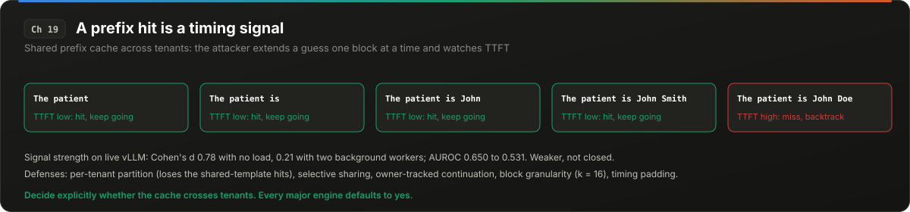</p>

> [!IMPORTANT]
> **At a glance.** A prefix hit is a timing signal an attacker can read one block at a time. Load weakens it (Cohen's d 0.78 to 0.21) but does not close it. Decide cross-tenant sharing explicitly.

### 19.1 The channel

A prefix-cache hit produces a measurably lower TTFT than a miss. In a multi-tenant deployment where the cache is shared across users, an attacker who can submit prompts and measure TTFT can learn whether a given prefix has been seen by the server before. Because hashes chain from the first block (Chapter 8), the attacker can extend a guessed prefix one token (or one block) at a time and observe where the timing changes: a token-by-token reconstruction of another tenant's prompt, including PII and system prompts.

This is not theoretical. Published attacks reconstruct victim prompts on vLLM and SGLang with automatic prefix caching enabled; a black-box study found that major hosted services (named in the paper: Claude, DeepSeek, Azure OpenAI) use KV or semantic cache sharing and are in principle susceptible. A 2026 extension (SpliceLeak) targets non-prefix KV fusion in RAG serving, where retrieved chunks are cached independently of position, bypassing the strict-prefix requirement.

The channel is most reliable under low load, with longer shared prefixes, and on larger models where recomputation is expensive (the hit/miss timing gap is larger).

### 19.2 Contention degrades the signal, but does not close it

A 2026 study on live shared vLLM servers measured the timing signal's reliability as background load increased. Mean Cohen's d (effect size separating hit from miss timings) dropped from 0.78 with no competing load to 0.21 with two synthetic background workers; adding more workers produced no statistically detectable further drop. AUROC fell from 0.650 to 0.531 near 61% request overlap and partly recovered to 0.574 at saturation. Attacks measured on a quiet system overestimate what works in production, and a production system at 3 a.m. is a quiet system.

### 19.3 Defenses and their costs

| Defense | Mechanism | Cost |
|---|---|---|
| Per-tenant cache partition | No cross-user reuse at all | Loses the shared system-prompt hits that produce 97% of enterprise reuse (Chapter 7) |
| Selective sharing (SafeKV) | Classify blocks as safe (shared template text) or sensitive (user content) at creation; share only safe blocks | Classification pipeline in the serving path; recovers most of the sharing benefit |
| Owner-tracked continuation (CacheSolidarity) | Allow initial sharing but force recomputation when a prefix is requested by a second distinct user | Degrades the attack from one token per guess to many; does not close the channel |
| Minimum share granularity | Share prefixes only in blocks of *k* ≥ 2 tokens (or larger) | Forces the attacker to guess *k* tokens at once; exponential cost increase per block |
| Timing padding | Add jitter or pad TTFT to a floor | Direct latency cost; must exceed the hit/miss gap, which is large for big models |

For a sovereign or regulated deployment, the usual answer is per-tenant partition plus a shared, non-sensitive template cache maintained separately. The template cache can be shared because it contains nothing a tenant wrote.

### 19.4 What to do

1. Decide explicitly whether the prefix cache crosses tenant boundaries. The default in every major engine is that it does.
2. If it does, implement at least block-granularity sharing (block size 16 already provides *k* = 16) and audit whether any path shares at finer granularity.
3. For RAG with non-prefix KV fusion, treat cached chunks as user data.
4. Log TTFT per tenant; an attacker's probe pattern (many short requests with incrementally longer prefixes) is detectable.

<details>
<summary><b>Sources</b></summary>

- "The Early Bird Catches the Leak" (KV and semantic cache timing attacks, hosted-service study), arXiv 2409.20002: https://arxiv.org/html/2409.20002v5
- SafeKV (selective sharing), arXiv 2508.08438: https://arxiv.org/pdf/2508.08438v2
- Contention-induced reliability collapse in KV timing channels, arXiv 2609.06853: https://arxiv.org/pdf/2609.06853
- "Agent-Assisted Side-Channel Attacks on Non-Prefix KV Cache in RAG" (SpliceLeak), arXiv 2606.21842: https://arxiv.org/abs/2606.21842
- CacheSolidarity and vulnerability summaries: https://www.promptfoo.dev/lm-security-db/vuln/llm-prefix-cache-reconstruction-437934e8 and https://promptfoo.dev/lm-security-db/vuln/kv-cache-sharing-timing-side-channel-37989546/


</details>

<p align="right"><a href="#contents">Back to contents</a></p>

---

# Part V: Arabic Inference Hygiene

<p align="center">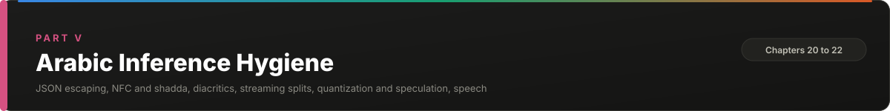</p>

Volume I, Chapter 31 established the tokenization tax: Arabic costs 2x to 3x the tokens of English for the same content on most tokenizers, and that multiplier propagates through every cost, latency, and capacity formula in the book. This part goes one level down. It is about the ways Arabic text gets damaged, inflated, or de-duplicated-out-of-existence between the user's keyboard and the model's first layer, and about the places where optimizations tuned on English quietly fail on Arabic.

Several measurements in this part were made for this handbook because no published source existed. They used a 33k-word Arabic Wikipedia sample for MSA, and 3,000-line samples from two public diacritized corpora (arbml/tashkeela and Abdou/arabic-tashkeel-dataset) for diacritized text. Tokenizers were loaded from their public `tokenizer.json` or SentencePiece files. The scripts are in Appendix B. Rerun them on your own corpus before trusting any number here for your deployment.

## 20. Arabic Text Hygiene: JSON Escaping, Unicode Normalization, and Diacritics

<p align="center"></p>

<p align="center">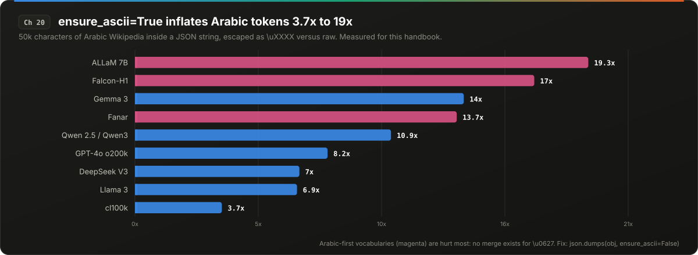</p>

> [!IMPORTANT]
> **At a glance.** `ensure_ascii=True` inflates Arabic 3.7x to 19.3x. NFC reorders shadda on 55% of diacritized lines and breaks the prefix cache 18% in. Classic normalization adds tokens.

### 20.1 `ensure_ascii=True`: the 3.7x to 19x inflation

Python's `json.dumps` defaults to `ensure_ascii=True`, which escapes every non-ASCII character as `\uXXXX`. Most JSON libraries in other languages have an equivalent default or a commonly-used option. The output is valid JSON and parses back to the same string, so nothing breaks. What changes is the token count.

Measured on 50k characters of Arabic Wikipedia wrapped in a JSON string, escaped versus raw:

| Tokenizer | Token inflation from escaping |
|---|---|
| cl100k (GPT-4 era) | 3.7x |
| Llama 3 | 6.9x |
| DeepSeek V3 | 7.0x |
| GPT-4o o200k | 8.2x |
| Qwen 2.5 / Qwen3 | 10.9x |
| Fanar | 13.7x |
| Gemma 3 | 14.0x |
| Falcon-H1 | 17.0x |
| ALLaM 7B | 19.3x |

One phrase: "المملكة العربية السعودية" is 6 tokens raw and 70 tokens escaped on o200k; 7 raw and 114 escaped on Qwen3.

The ordering is the important part. The tokenizers that invested vocabulary in Arabic (ALLaM, Falcon-H1, Fanar) are hurt most, because an escaped Arabic character is a sequence like `\u0627` that no Arabic-aware vocabulary has a merge for; it falls back to roughly 4 to 6 tokens per character. An Arabic-first model deployed behind an escaping serializer loses its entire tokenizer advantage and then some.

Where this happens in practice: tool-result serializers in agent frameworks, MCP server responses, logging and tracing layers that re-serialize, database drivers that store JSON as text, and any Python code path that calls `json.dumps` without `ensure_ascii=False`. The failure presents as a context window that fills faster than expected and a TTFT that is higher than the prompt length seems to justify. The prompt looks short in characters and is long in tokens.

**Fix:** `json.dumps(obj, ensure_ascii=False)` everywhere, and audit every serializer in the request path by rendering a tool result and counting tokens.

**Unverified:** whether grammar-constrained decoders push the model itself toward emitting `\u` escapes for Arabic strings in generated JSON. No measurement was found. If your schema-constrained outputs contain `\u06`, measure it.

### 20.2 NFC reorders shadda and vowels, and breaks the prefix cache

Arabic diacritics are Unicode combining marks with canonical combining classes. Shadda (U+0651) has class 33. Fatha, damma, and kasra (U+064E to U+0650) have classes 30 to 32, and the tanween marks (U+064B to U+064D) have classes 27 to 29. Unicode canonical ordering sorts combining marks by class, so NFC normalization rewrites "shadda then vowel" (class 33 then class 30) into "vowel then shadda" (class 30 then class 33).

The typed order in practice is shadda first. In the Abdou diacritized corpus, 61% of adjacent shadda/vowel pairs were in typed order (shadda, then vowel), meaning NFC changes them. Measured on 3,000 lines (305k words):

- NFC changes 55% of lines and 12% of words.
- On the affected lines, the token sequences under every tokenizer diverge on average **18% into the line**, so the remaining 82% of that line is a prefix-cache miss.
- Total token count shifts by 0% to +1.8%, so the inflation is negligible; the cache effect is not.

The two strings render identically. Nothing in a UI or a log reveals the difference.

**Qwen is immune.** The Qwen 2.5 and Qwen3 `tokenizer.json` files declare `"normalizer": {"type": "NFC"}`, so the tokenizer normalizes on entry and both orderings produce the same tokens. Llama 3 and Falcon-H1 declare a null normalizer; DeepSeek V3 an empty one; Gemma 3 and Fanar only a space-replacement normalizer. On all of those, the two byte sequences are two token sequences.

**Where the inconsistency comes from:** JavaScript `String.prototype.normalize()` in a frontend; a database collation that normalizes on write; PDF text extraction; a copy-paste from a source that normalized. Any pipeline with two of these in different states produces both orderings for the same text.

**Fix:** normalize once, at ingress, to one form (NFC is the reasonable choice since one major tokenizer already assumes it), and never again downstream. Log the normalization state as request metadata.

No published source for this finding was found; it is a measurement made for this handbook.

### 20.3 The classic normalization makes tokens worse

Arabic NLP preprocessing has a traditional normalization step inherited from the statistical era: unify alef variants (أ إ آ → ا), ta marbuta to ha (ة → ه), alef maqsura to ya (ى → ي). It was useful for sparse n-gram models. Measured on modern BPE tokenizers, it increases token count on every one tested:

| Tokenizer | Token change after classic normalization |
|---|---|
| Gemma 3 | +1.9% |
| Llama 3, Qwen3, DeepSeek V3 | +3% to +6% (range across the three) |
| GPT-4o o200k | +8.0% |
| Falcon-H1 | +11.2% |

The mechanism: the tokenizers were trained on natural text where "المملكة" ends in ta marbuta; the merge for that word exists in that form. Normalizing to "المملكه" produces a form the tokenizer saw less often, with fewer merges. The normalization also destroys information the model was trained to use.

A published counterpoint (AraToken, 2025) reports an 8% fertility drop from normalization, but for tokenizers trained on normalized text. The rule is: match the tokenizer's training distribution. For every current general-purpose model, that means unnormalized text.

### 20.4 Diacritics multiply the token count

Full diacritization (tashkeel on every letter) is standard in Quranic text, classical poetry, children's content, some legal text, and pedagogical material. Measured tokens per word, undiacritized → fully diacritized:

| Tokenizer | MSA (natural) | Undiacritized | Fully diacritized |
|---|---|---|---|
| GPT-4o o200k | 1.94 | 1.66 | 5.12 |
| Llama 3 | 2.31 | 1.93 | 4.84 |
| Qwen 2.5 / Qwen3 | 2.34 | 1.90 | 6.61 |
| Gemma 3 | 2.10 | 1.73 | 4.39 |
| DeepSeek V3 | 2.26 | 1.89 | 4.71 |
| Falcon-H1 | 1.80 | 1.57 | 4.87 |
| ALLaM 7B | 1.50 | 1.25 | 3.08 |
| Fanar | 2.14 | 1.76 | 5.65 |
| cl100k / phi-4 | 4.26 | 3.54 | 7.02 |
| bge-m3 / multilingual-e5 (embedding) | 1.88 | 1.58 | 6.64 |

The EACL 2026 study (Inoue, Alhafni, Habash, Baldwin) reports the same pattern with its own corpus and adds Jais: Jais Chat 13B goes from 1.9 to 9.3 tokens per word; Jais 2 8B from 1.9 to 10.1; ALLaM 7B from 1.4 to 4.0; Fanar 9B from 2.4 to 6.7. The Arabic-first tokenizers show the largest multipliers because their vocabularies contain whole undiacritized words and nothing for the diacritized forms.

The same study measured accuracy: full diacritization drops Llama 3.1 on ArabicMMLU from 56.2 to 42.5, Jais from 58.2 to 46.3, ALLaM from 70.0 to 64.2; Jais on AraTrust from 78.7 to 56.5. And the opposite intervention, stripping the sparse diacritics that occur naturally in text, gave no significant gain and was often slightly worse.

**RAG consequence.** An embedding model with a 512-token window holds roughly 270 words of MSA and roughly 80 words of fully diacritized text. A chunker sized on MSA produces chunks that truncate silently on diacritized documents. Chunk by token count, measured with the embedding model's tokenizer, not by word or character count.

### 20.5 Eastern Arabic digits

Measured on 300 numbers (small sample): Eastern Arabic digits (٠١٢...) cost 1.56x to 2.08x the tokens of Western digits on o200k, Llama 3, Qwen3, and DeepSeek V3, and 2.63x on bge-m3. Gemma 3, Fanar, ALLaM, and Falcon-H1 showed no penalty. If your content has Eastern digits (common in Gulf government documents), check your tokenizer, and consider normalizing digits (which, unlike letter normalization, does not destroy semantic information the model needs).

### 20.6 Code-switching

A two-sentence test showed Arabic-English code-switched text costing fewer tokens per word than the pure-Arabic rendering of the same content (o200k: 1.48 versus 1.95). The sample is far too small to generalize. The direction is plausible (the English technical terms are single tokens, their Arabic translations are not), and it suggests that mixed-register Gulf business text may be cheaper than its purist Arabic equivalent, which is a point worth measuring on your own traffic.

### 20.7 The ingress checklist

1. `ensure_ascii=False` in every serializer. Count tokens on a rendered tool result to verify.
2. NFC once at ingress. Record it. Never normalize downstream.
3. No letter normalization. Digit normalization only if measured to help.
4. Chunk by embedding-tokenizer token count. Test with a diacritized document.
5. Add a diacritized sample and an Eastern-digit sample to your token-cost regression suite.

<details>
<summary><b>Sources</b></summary>

- Inoue, Alhafni, Habash, Baldwin, EACL 2026 Findings (diacritization and tokenization): https://aclanthology.org/2026.findings-eacl.22.pdf
- AraToken (normalization effect on normalized-trained tokenizers), arXiv 2512.18399: https://arxiv.org/html/2512.18399v1
- Corroborating reports of the escaping bug class: https://github.com/charliee1w/consolidation-memory/issues/5 and https://github.com/QuantumNous/new-api/pull/7369
- Qwen3 tokenizer.json (NFC normalizer; the chat template is in tokenizer_config.json): https://huggingface.co/Qwen/Qwen3-8B/raw/main/tokenizer.json
- Measurements for this handbook: Appendix B.


</details>

<p align="right"><a href="#contents">Back to contents</a></p>

---

## 21. Streaming, Quantization, and Speculation for Arabic

<p align="center"></p>

<p align="center">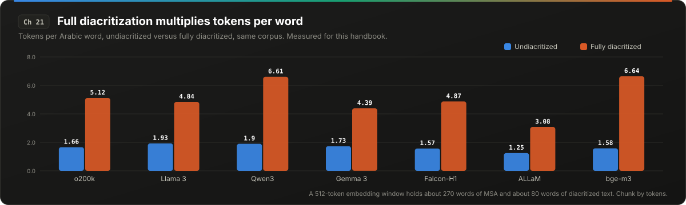</p>

> [!IMPORTANT]
> **At a glance.** Qwen splits tanween across tokens: one U+FFFD risk per 12 diacritized words. No measured acceptance rate for Arabic speculation exists. Default to n-gram until you measure.

### 21.1 Which tokenizers split Arabic characters

Chapter 11 described incremental-detokenization bugs that surface when a token is a partial UTF-8 sequence. Arabic letters are 2 bytes in UTF-8; the usual assumption is that 2-byte scripts are safe and only emoji (4 bytes) and some CJK (3 bytes) trigger the bug. Measured share of emitted tokens that are not valid UTF-8 on their own:

| Tokenizer | MSA | Fully diacritized |
|---|---|---|
| Qwen 2.5 / Qwen3 | 0.73% | 1.96% to 2.63% |
| cl100k | 3.96% | 4.33% to 5.28% |
| Llama 3 | 0.07% | 0.02% |
| GPT-4o o200k | 0.00% | 0.00% to 0.23% |
| Gemma 3, Fanar, ALLaM, Falcon-H1 | roughly 0 | roughly 0 |

On Qwen, the split characters are mostly kasratan (ٍ) and dammatan (ٌ), then ظ and ؤ. That is one split character per 117 words of MSA and **one per 12 words of diacritized text**. A detokenizer that decodes per token and emits immediately produces U+FFFD at each one. Correct engines hold the bytes; the bugs in Chapter 11 are the cases where they do not, and `max_tokens` truncation or a stop sequence landing mid-character is the trigger that short tests never exercise.

Test: generate diacritized Arabic with `max_tokens` set to successive odd values and check every response for U+FFFD and for prompt leakage in the first delta.

### 21.2 Quantization costs Arabic 2.5x to 3x what it costs English

Chapter 4 gave the numbers; the Arabic-specific summary:

- 3-bit GPTQ with English calibration: perplexity ratio 1.35x English against 4.37x Arabic on Qwen2.5-3B; Arabic GlobalMMLU 48.7 to 28.0.
- 4-bit NF4 on Gemma 4 E4B: English -4.3 points, Arabic -11.4 on MMLU-ProX Lite. Qwen 3.5 4B: Arabic -2.7, so the sensitivity is model-dependent.
- Cohere (large models, 4-bit): Arabic about -1.2% on automatic metrics, with human-rater deltas for other non-Latin languages near -16%.

No published Q4-versus-FP16 ArabicMMLU numbers for Jais, ALLaM, or Fanar were found. If you deploy any of them quantized, you are the first to measure it; do so before shipping, with KL divergence on Arabic held-out text (Chapter 4's protocol) and a human review of long generations.

Calibration is the controllable variable. Calibrate GPTQ and AWQ on Arabic text, in the register you serve, and the English-calibrated penalty largely disappears in the published experiments.

### 21.3 Speculative decoding and the curse of multilinguality

Chapter 9 explained that acceptance rate α determines whether speculative decoding helps or hurts, and that α is a property of the traffic. For non-English traffic, the published evidence is consistent:

- Small draft models have disproportionately weak multilingual ability (the curse of multilinguality: capacity spent on many languages leaves little per language, and small models have the least capacity). Acceptance rates correlate with how well-resourced the language is.
- On MGSM (Qwen2.5 0.5B drafter, 3B verifier), the gap between the best and worst language was 13 points of α, and the slowest languages were also the least accurate.
- On eleven low-resource languages (Qwen 3.5, 9B verifier, 0.8B draft), baseline α was 0.40 and speedup 1.02x, which is to say no speedup. Task-specific distillation of the drafter raised α to 0.60 and speedup to 1.28x, but the distilled drafter generalized poorly to a different task. N-gram drafters, with lower α but near-zero draft cost, consistently delivered larger speedups than model drafters.
- FastDraft (a draft-training recipe) states explicitly that its acceptance results were validated only in English and may not generalize.

**No measured α for Arabic specifically was found.** Arabic is better-resourced than the eleven languages in the distillation study, so its α is likely between that study's 0.40 and the English numbers, but "likely" is not a measurement. Before enabling EAGLE-3 or a draft model on Arabic traffic, log α per language for a day. If it is under the break-even for your concurrency (Chapter 9), prefer an n-gram drafter or leave speculation off for that segment.

### 21.4 What to do

1. Add the odd-`max_tokens` streaming test to CI, with diacritized text, on every tokenizer you serve.
2. Never ship a quantized checkpoint on Arabic traffic without Arabic KLD and Arabic human review.
3. Calibrate quantization on Arabic.
4. Measure α per language before enabling speculation. Default to n-gram for Arabic until measured.

<details>
<summary><b>Sources</b></summary>

- vLLM issues 48853 and 59089; Dynamo issue 12630 (Chapter 11)
- Quantization: arXiv 2608.11786, arXiv 2608.09941 (preprints), Cohere arXiv 2407.03211 (Chapter 4)
- "Speculative Decoding Across Languages" (eleven languages, distillation and n-gram), arXiv 2605.30580: https://arxiv.org/html/2605.30580
- "The Disparate Impacts of Speculative Decoding," arXiv 2510.02128: https://arxiv.org/pdf/2510.02128
- FastDraft limitations section, arXiv 2411.11055: https://arxiv.org/pdf/2411.11055
- AdaSpec and Multi-SpecBench (multilingual SD benchmark, AAAI 2026): https://huggingface.co/datasets/nguyenlab/Multi-SpecBench
- Measurements for this handbook: Appendix B.


</details>

<p align="right"><a href="#contents">Back to contents</a></p>

---

## 22. Arabic Speech Inference: Whisper, Dialects, and Silence

<p align="center"></p>

<p align="center">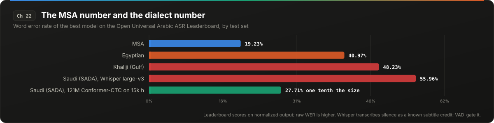</p>

> [!IMPORTANT]
> **At a glance.** The best leaderboard model scores 19% WER on MSA and 48% on Khaliji. Whisper transcribes silence as a subtitle credit. VAD-gate everything and evaluate on raw output.

### 22.1 The MSA number and the dialect number

The Open Universal Arabic ASR Leaderboard (Interspeech 2025) is the broadest published comparison. Average word error rate across its test sets:

| Model | Average WER |
|---|---|
| NVIDIA Conformer-CTC with language model | 32.91% |
| Whisper large-v3 | 36.86% |
| Whisper large-v3-turbo | 40.05% |
| Parakeet-CTC-1.1b | 46.54% |

The average hides the number that matters for a Gulf deployment. The best model on the leaderboard scores 19.23% WER on MSA, 40.97% on Egyptian, and **48.23% on Khaliji**. Common Voice Arabic (MSA, read speech) gives Whisper large-v3 a WER of 17.83%, which is the number teams see when they evaluate and the number that has nothing to do with a Saudi call center.

On the SADA corpus (Saudi dialectal audio), Whisper large-v3 scored 55.96% WER against 27.71% for a 121M-parameter Conformer-CTC trained on 15k hours of weakly labeled Saudi speech. A model one tenth the size, trained on the right data, halved the error.

The leaderboard also normalizes before scoring: diacritics stripped, hamza forms unified, digits normalized. The WER on raw output is higher than any number in the table.

### 22.2 Whisper hallucinates on silence, deterministically

Whisper large-v3 transcribes pure silence as a specific Arabic string (a subtitle-credit artifact from its training data, reproducibly the same phrase). It is not random noise; it is a learned prior for "Arabic audio with no speech." `logprob_threshold` and `no_speech_threshold` help little on v3. The working mitigation is VAD gating (do not send silence to the model at all) plus a phrase blocklist for the known artifacts. Any streaming pipeline with Arabic audio and pauses will produce this artifact in production without the gate.

### 22.3 Real-time factor

On an A100, real-time factor (processing time / audio duration): Whisper large-v2 0.4789, Conformer-CTC greedy 0.047, wav2vec2 XLS-R 0.0064. Whisper is 10x slower than a CTC model and 75x slower than the lightest option. For streaming with sub-second latency targets, a CTC or RNN-T architecture with a dialect-trained model is the viable path; Whisper is a batch tool.

### 22.4 TTS

The only Arabic time-to-first-audio numbers found were vendor-published (one provider's own benchmark of itself and competitors: 120 ms, 137 ms, 280 ms medians). They are not independent measurements and are listed here only so they are not mistaken for ones. No primary latency numbers for self-hosted Arabic streaming TTS (XTTS, CosyVoice, Fish Speech) or streaming Parakeet were found. If you measure them, publish them.

### 22.5 What to do

1. Evaluate STT on your dialect, with your audio conditions, on raw (unnormalized) output.
2. VAD-gate everything. Blocklist the known silence artifacts.
3. For streaming, start from a CTC or RNN-T model and fine-tune on dialect data; do not start from Whisper.
4. Treat vendor TTS latency numbers as marketing until reproduced.

<details>
<summary><b>Sources</b></summary>

- Open Universal Arabic ASR Leaderboard, Interspeech 2025: https://www.isca-archive.org/interspeech_2025/wang25_interspeech.pdf
- SADA corpus results (Whisper versus Saudi-trained Conformer), arXiv 2504.12254: https://arxiv.org/html/2504.12254v2
- Whisper silence hallucination in Arabic (GitHub discussion): https://github.com/openai/whisper/discussions/2608
- Vendor TTS benchmark (not independent): https://silma.ai/blog/best-low-latency-arabic-text-to-speech-apis-for-developers-2026-benchmark


</details>

<p align="right"><a href="#contents">Back to contents</a></p>

---

# Appendix A: Production Audit Checklist for Volume II

Each item maps to a chapter. An item is "done" when you have the number for your own system, not when you have read the chapter.

**Numerics**
- [ ] Batch size recorded as metadata on every eval run; evals run at a fixed batch size (Ch. 1)
- [ ] KV-cache precision validated at the maximum served context with a retrieval task (Ch. 2)
- [ ] Windowed layers excluded from FP8 KV on hybrid models (Ch. 2)
- [ ] 4-bit formats validated on your model size, not the vendor's (Ch. 3)
- [ ] Quantization gated on KL divergence per served language; calibration text in served languages (Ch. 4)
- [ ] Per-GPU output-hash canary running; fp16/FP8 evaluated against bf16 for inference, with activation-overflow check (Ch. 5)

**Scheduler and cache**
- [ ] Preemption counter alerting; `watermark` set; `long_prefill_token_threshold` set (Ch. 6)
- [ ] Ideal prefix-cache hit rate computed from a traffic replay; TTL set from inter-turn gap distribution (Ch. 7)
- [ ] Rendered token IDs diffed across two turns; templates audited for time and turn-indexed logic; one pinned serializer for tool results (Ch. 8)
- [ ] Effective block size logged for hybrid models; KV budget per LoRA adapter (Ch. 8)
- [ ] α logged per traffic segment and compared to break-even at production concurrency (Ch. 9)
- [ ] Speculation and structured output benchmarked together; α reported pre-grammar-filter (Ch. 10)

**Host and hardware**
- [ ] API-process CPU monitored separately; `--api-server-count` sized (Ch. 11)
- [ ] Odd-`max_tokens` streaming test in CI for every served script (Ch. 11, 21)
- [ ] Engine template rendering diffed against the model author's reference (Ch. 11)
- [ ] CUDA graph capture list set from the production batch-size histogram; graph memory accounted in KV sizing (Ch. 12)
- [ ] All-reduce latency measured at 128 KB to 1 MB on your topology before choosing TP (Ch. 13)
- [ ] Decode power measured; clock lock evaluated on decode pools (Ch. 14)
- [ ] Startup profiled; compiled artifacts cached; warm standby sized to measured cold start (Ch. 15)

**Fleet**
- [ ] Per-expert token counts instrumented; hot-expert replication from live stats (Ch. 16)
- [ ] Session-sticky routing; session-level p90 reported (Ch. 17)
- [ ] Accuracy check inside every throughput benchmark; canary eval on the production path (Ch. 18)
- [ ] Cross-tenant prefix sharing decided explicitly and documented (Ch. 19)

**Arabic**
- [ ] `ensure_ascii=False` verified by token count on a rendered tool result (Ch. 20)
- [ ] NFC once at ingress, recorded, never repeated (Ch. 20)
- [ ] No letter normalization; chunking by embedding-tokenizer tokens; diacritized and Eastern-digit samples in the regression suite (Ch. 20)
- [ ] Arabic KLD and human review on every quantized checkpoint (Ch. 21)
- [ ] α measured per language before enabling speculation (Ch. 21)
- [ ] STT evaluated on dialect audio, raw output; VAD gating and artifact blocklist in place (Ch. 22)

---

# Appendix B: Measurement Scripts

These reproduce the Arabic measurements in Chapters 20 and 21. They are also checked in as runnable files under [`scripts/`](scripts/), with a short setup guide. They expect `tokenizer.json` files under `tok/<name>/` (downloaded from the respective Hugging Face repos), a SentencePiece model for ALLaM at `tok/allam/tokenizer.model`, and text corpora under `data/`. Install: `pip install tokenizers tiktoken sentencepiece pyarrow huggingface_hub`.

### B.1 Fertility, normalization, digits, and JSON escaping

```python
import re, json, unicodedata, collections
import tiktoken, sentencepiece as spm
from tokenizers import Tokenizer

def encoder(name):
    if name == "o200k":
        e = tiktoken.get_encoding("o200k_base")
        return lambda s: e.encode(s, disallowed_special=())
    if name == "cl100k":
        e = tiktoken.get_encoding("cl100k_base")
        return lambda s: e.encode(s, disallowed_special=())
    if name == "allam":
        sp = spm.SentencePieceProcessor(model_file="tok/allam/tokenizer.model")
        return sp.encode
    tk = Tokenizer.from_file(f"tok/{name}/tokenizer.json")
    return lambda s: tk.encode(s, add_special_tokens=False).ids

TOKENIZERS = ["o200k", "cl100k", "llama3", "qwen3", "gemma3",
              "deepseek-v3", "falcon-h1", "allam", "fanar", "bge-m3"]

# MSA corpus: keep lines that are mostly Arabic script
msa = open("data/wiki_ar.txt", encoding="utf-8").read()
msa = "\n".join(l for l in msa.split("\n")
                if len(l) > 40 and sum('؀' <= c <= 'ۿ' for c in l) / len(l) > 0.6)[:200000]

# Diacritized corpus: one fully vocalized line per row
diac = open("data/tashkeela_sample.txt", encoding="utf-8").read()
DIAC_RE = re.compile('[ً-ْ]')
undiac = DIAC_RE.sub('', diac)

classic_norm = lambda s: re.sub('[أإآ]', 'ا', s).replace('ى', 'ي').replace('ة', 'ه')
east = str.maketrans("0123456789", "٠١٢٣٤٥٦٧٨٩")
nums = " ".join(str(n) for n in [2024, 1445, 3.5, 120000, 17, 99, 2030, 750, 48, 1000000, 365, 12, 5, 88, 1979] * 20)
json_sample = msa[:50000]

def tpw(enc, text):
    return len(enc(text)) / len(text.split())

print("tokenizer | MSA t/w | undiac t/w | full-diac t/w | classic-norm delta% | east-digit x | json-escape x")
for name in TOKENIZERS:
    enc = encoder(name)
    norm_delta = (len(enc(classic_norm(msa))) - len(enc(msa))) / len(enc(msa)) * 100
    digit_x = len(enc(nums.translate(east))) / len(enc(nums))
    esc_x = len(enc(json.dumps(json_sample))) / len(enc(json.dumps(json_sample, ensure_ascii=False)))
    print(f"{name} | {tpw(enc, msa):.2f} | {tpw(enc, undiac):.2f} | {tpw(enc, diac):.2f} | "
          f"{norm_delta:+.1f} | {digit_x:.2f} | {esc_x:.1f}")
```

### B.2 NFC shadda reordering and prefix divergence

```python
import unicodedata, re
from tokenizers import Tokenizer

diac_lines = open("data/abdou_vocalized_sample.txt", encoding="utf-8").read().split("\n")
SHADDA = 'ّ'
VOWEL = '[ً-ِْ]'
txt = "\n".join(diac_lines)
print("shadda->vowel (typed order):", len(re.findall(SHADDA + VOWEL, txt)),
      " vowel->shadda (NFC order):", len(re.findall(VOWEL + SHADDA, txt)))

changed_lines = sum(unicodedata.normalize("NFC", l) != l for l in diac_lines) / len(diac_lines)
words = txt.split()
changed_words = sum(unicodedata.normalize("NFC", w) != w for w in words) / len(words)
print(f"NFC changes {changed_lines:.0%} of lines and {changed_words:.0%} of words")

for name in ["llama3", "qwen3", "gemma3", "deepseek-v3", "falcon-h1", "fanar"]:
    tk = Tokenizer.from_file(f"tok/{name}/tokenizer.json")
    enc = lambda s: tk.encode(s, add_special_tokens=False).ids
    fracs = []
    for l in diac_lines[:800]:
        x, y = enc(l), enc(unicodedata.normalize("NFC", l))
        if x != y:
            i = next((i for i, (p, q) in enumerate(zip(x, y)) if p != q), min(len(x), len(y)))
            fracs.append(i / len(x))
    import json
    normalizer = json.load(open(f"tok/{name}/tokenizer.json")).get("normalizer")
    mean_div = sum(fracs) / len(fracs) if fracs else float('nan')
    print(f"{name}: normalizer={normalizer} | lines diverging={len(fracs)}/800 | "
          f"mean first-divergence at {mean_div:.0%} of line")
```

### B.3 Partial-UTF-8 tokens (streaming split risk)

```python
import collections, unicodedata
from tokenizers import Tokenizer
import tiktoken

def partial_share_hf(name, text):
    tk = Tokenizer.from_file(f"tok/{name}/tokenizer.json")
    enc = tk.encode(text, add_special_tokens=False)
    bad = sum('�' in tk.decode([i]) for i in enc.ids)
    cov = collections.Counter()
    for (s, e) in enc.offsets:
        for k in range(s, e):
            cov[k] += 1
    split_chars = collections.Counter(text[k] for k, v in cov.items() if v > 1)
    total = sum(split_chars.values())
    print(f"{name}: partial tokens {bad/len(enc.ids):.2%} | "
          f"1 split char per {len(text.split())/max(total,1):.0f} words | "
          f"top: {[(unicodedata.name(c, '?'), n) for c, n in split_chars.most_common(4)]}")

def partial_share_tiktoken(encname, text):
    e = tiktoken.get_encoding(encname)
    ids = e.encode(text, disallowed_special=())
    bad = 0
    for i in ids:
        try:
            e.decode_single_token_bytes(i).decode()
        except UnicodeDecodeError:
            bad += 1
    print(f"{encname}: partial tokens {bad/len(ids):.2%}")

for corpus_name, path in [("MSA", "data/wiki_ar.txt"), ("diacritized", "data/tashkeela_sample.txt")]:
    text = open(path, encoding="utf-8").read()[:200000]
    print(f"--- {corpus_name} ---")
    for n in ["qwen3", "llama3", "gemma3", "deepseek-v3", "falcon-h1", "fanar"]:
        partial_share_hf(n, text)
    for en in ["o200k_base", "cl100k_base"]:
        partial_share_tiktoken(en, text)
```

### B.4 Streaming truncation test (run against a live endpoint)

```python
# Sends diacritized Arabic prompts with odd max_tokens values and checks every
# streamed delta for U+FFFD and for prompt leakage in the first delta.
import requests, json

URL = "http://localhost:8000/v1/chat/completions"
PROMPT = "اكتب فقرة مشكّلة بالكامل عن أهمية القراءة."
problems = 0
for max_tokens in [7, 13, 21, 33, 47, 61, 83, 101]:
    r = requests.post(URL, json={"model": "served-model", "stream": True, "max_tokens": max_tokens,
                                 "messages": [{"role": "user", "content": PROMPT}]}, stream=True)
    deltas = []
    for line in r.iter_lines():
        if line.startswith(b"data: ") and line != b"data: [DONE]":
            chunk = json.loads(line[6:])
            d = chunk["choices"][0]["delta"].get("content")
            if d:
                deltas.append(d)
    text = "".join(deltas)
    if "�" in text:
        problems += 1; print(f"max_tokens={max_tokens}: U+FFFD in output")
    if deltas and PROMPT[:10] in deltas[0]:
        problems += 1; print(f"max_tokens={max_tokens}: prompt leaked into first delta")
print("problems:", problems)
```

---

*End of Volume II.*

---

## Errata and contributions

Numbers age. Engine defaults change between releases, preprints get reproduced or refuted, and a measurement made on one corpus will not match yours exactly. If you find a number that is wrong, a source that moved, or a mechanism that no longer matches the code, open an issue with the chapter and the evidence. Reruns of the Appendix B scripts on other tokenizers and corpora are especially welcome as pull requests. See [CONTRIBUTING.md](CONTRIBUTING.md).

## How to cite

```bibtex
@book{haroon2026inference2,
  author = {Haroon, Hesham},
  title  = {The LLM Inference Handbook, Volume II: Production Failure Modes},
  year   = {2026},
  url    = {https://github.com/h9-tec/LLM-Inference-Handbook-Vol2}
}
```

A `CITATION.cff` file is included, so the "Cite this repository" button on GitHub works too.

## License

The text and figures are licensed under [CC BY 4.0](LICENSE). You can share and adapt them with attribution. The measurement scripts in `scripts/` and the figure generator in `assets/_generate.py` are under the [MIT License](LICENSE-CODE).

## Author

Written by Hesham Haroon ([GitHub](https://github.com/h9-tec), [Hugging Face](https://huggingface.co/HeshamHaroon)). Volume I, covering fundamentals through production serving, is at [h9-tec/LLM-Inference-Handbook](https://github.com/h9-tec/LLM-Inference-Handbook).

The Arabic measurements in Part V were made for this book because no published source existed. They are offered as a starting point, not a final word. If you serve Arabic in production and your numbers differ, I would like to hear about it.
